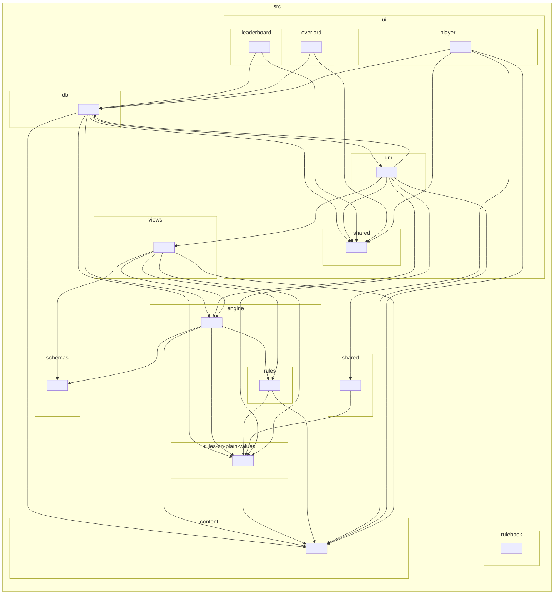

# Architecture

How Kingdoms Call works now: one short paragraph a part, each linking to its topic file under
[architecture/](architecture/), which has the detail. Read this, then the topic file your work touches, then the
entries of [traps.md](traps.md) by title. Line numbers drift; search for the names given here.

## The shape in one paragraph

A static site with no server of its own. Every published page is an HTML file and its one script and one stylesheet
(`assets/<page>-<hash>.js`, `assets/<page>-<hash>.css`), built by Vite from the ES modules in `src/`. The pages talk
straight to a Supabase Postgres database from the browser, using supabase-js and the project's public (anon) key.
**The turn engine runs in the GM's browser tab**: the GM portal generates worlds, runs the bots, resolves turns and
writes each realm's report. Players only submit orders and read what they're given.

## The parts

- **The build** ([the-build-from-src-to-site.md](architecture/the-build-from-src-to-site.md)). `npm run build` (`tools/build.ts`)
  runs Vite once per page (`src/*.html`), each page's entry `src/ui/<page>/page.ts`; `public/` is copied as it is.
  `site/` is the output: git-ignored, published by the deploy, opened by every test. Files are named by a hash of
  their content, and the deploy keeps the files a cached page still names. `npm run dev` serves `src/` against the
  local Supabase only. The folders of `src/`, the TypeScript check and the deploy's build jobs are there too.
- **The rule registry and the shared rules**
  ([the-rule-registry-and-the-one-source-for-shared-rules.md](architecture/the-rule-registry-and-the-one-source-for-shared-rules.md)).
  A content effect (a unit ability; since P1-19m a magic item's; since P1-19u a spell's; since P1-19aa a kind of a
  discovery's effect) is one row in `src/content/` and one entry in `src/engine/rules/the-registry-of-content-effects.ts`
  (an item's, `the-registry-of-magic-item-effects.ts`; a spell's, `the-registry-of-spell-effects.ts`:
  [its file](architecture/the-spells-registry-its-stages-and-how-to-add-a-spells-effect.md); a discovery's,
  `the-registry-of-discovery-effects.ts`:
  [its file](architecture/the-discoveries-registry-its-stages-and-how-to-add-a-discoverys-effect.md)), naming its effect at each
  stage of a hook point; the resolvers ask the stage's runner. `src/content/kingdoms-call-data.ts`
  is the one source of the tables both portals read, and `src/shared/` is the player portal's one door to the engine's
  rules on plain values.
- **A saved game** ([a-saved-game-its-version-its-upgrade-its-check.md](architecture/a-saved-game-its-version-its-upgrade-its-check.md)).
  A save holds what older builds wrote. Before every turn, `src/engine/saves/` reads its version, runs each numbered
  upgrade step, and checks the result with the saved state's Zod schema; a save the check refuses still plays, and the
  GM is told.
- **The pages** ([the-pages-how-a-portal-boots-and-how-a-page-builds-html.md](architecture/the-pages-how-a-portal-boots-and-how-a-page-builds-html.md)).
  What each published file is, the copy of supabase-js served with the site (its version and SHA-256 are
  [below](#supabase-js-the-copy-served-with-the-site)), the order a portal boots in, and `kcHtml` / `kcEsc`
  (`src/ui/shared/kc-safe.ts`), the one way a page builds HTML.
- **The turn engine** ([the-turn-engine.md](architecture/the-turn-engine.md)). A turn is two functions: `resolveTurn`
  (`src/engine/run-turn.ts`) works it out on plain data, and `runTurn` (`src/ui/gm/turn-shell.ts`), its shell, does the
  database and screen work: it loads the world and every slot, then saves the turn and each realm's report. Every line enters the GM's log through `emit`, as an event; `src/views/` builds each
  realm's report from what that realm may see, and writes the words. Dice come from `kcRng()`, time from `kcClock()`.
- **The database** ([the-database-and-what-it-holds.md](architecture/the-database-and-what-it-holds.md)). Supabase Postgres,
  its structure in `supabase/schemas/`. A rule that stops a player is enforced inside the database (access rules or
  database functions), since there is no server. Also the Hall of Fame's records, Dispatches, each page's version,
  and staging. How to change it: [supabase/README.md](../supabase/README.md).
- **The toolchain and the checks** ([the-toolchain-the-checks-and-the-harness.md](architecture/the-toolchain-the-checks-and-the-harness.md)).
  Vitest, Playwright, TypeScript, ESLint with the project's own rules (`tools/eslint-rules/`), dependency-cruiser,
  knip, Prettier, the Claude Code hooks, the ratchet, CI's jobs and the mutant scorer.
- **The tests' side** ([how-the-tests-reach-the-site.md](architecture/how-the-tests-reach-the-site.md),
  [the-balance-matrix.md](architecture/the-balance-matrix.md)). How a test loads a page, the engine or the site's code, and the
  balance matrix that measures an engine change. How to write a test: [tests/README.md](../tests/README.md).

### supabase-js: the copy served with the site

The pages load supabase-js from `vendor/` beside them (source: `public/vendor/`), not from a CDN. How to upgrade it:
[the pages' topic file](architecture/the-pages-how-a-portal-boots-and-how-a-page-builds-html.md#supabase-js-a-copy-served-with-the-site).

- **Version:** 2.117.3, the package's browser build (`dist/umd/supabase.js`) copied unchanged to
  `public/vendor/supabase-js-2.117.3.min.js`, with its licence beside it (`supabase-js-LICENSE.txt`).
- **SHA-256:** `d6a5c4414a5d4ce646d9c1de223aa7067d3ff664c15394ffeb7fcffc763354a3`. `npm test`'s
  `vendor-supabase` check fails if the file and this line disagree.

## The code's guardrails

These are CLAUDE.md's rules for the code (P1-09; the steps named bring the rest): (1) `src/engine/` and `src/views/` import no
Supabase client, `window` or UI code, so each function there runs on plain data (the imports: `npm run lint:arch`; the
page's names: lint); (2) no `Math.random` or `Date` there (lint: `Math.random` nowhere but `rng.ts`); (3) every line enters the GM's log through `emit`, with its
audience ([traps.md](traps.md#a-line-goes-through-emit)), and the engine emits events, never prose, which `src/views/` writes after perception (P1-12: `emit` throws on words, and lint refuses them); (4) a content effect lives in the rule registry, not in an `if` on its name inside a resolver (P1-19); (5) an
iteration order that can change a draw or the outcome is explicit; (6) all code and tests are TypeScript (P1-09e), with
no `any`, `@ts-ignore` or `eslint-disable` without a reviewed allowlist entry, and data crossing a boundary
(database, saved state, content) is parsed by its Zod schema (P1-10).

## The layers and the module map

Which folder of `src/` may import which is checked by dependency-cruiser (P1-13a): `npm run lint:arch`, in CI's static
job and in `npm run check`, with its rules in `.dependency-cruiser.mts`, every one an error.

- **`content/`** (the data file) imports nothing.
- **`engine/`** imports only `engine/` and `content/`; **`engine/rules-on-plain-values/`**, the rules the player portal
  shares, only itself and `content/`.
- **`engine/rules/`**, the rule registry ([the rule registry](architecture/the-rule-registry-and-the-one-source-for-shared-rules.md#the-rule-registry)), imports only itself,
  `engine/rules-on-plain-values/` and `content/`: an effect reaches the dice, the turn's state, a report or a hero's
  items only through what its stage and its runner are handed (P1-19a; the items' registry and `magic-items/`, P1-19m;
  the spells' registry and `spells/`, P1-19u; the discoveries' registry and `discoveries/`, P1-19aa, whose unit-class
  tests are in `engine/rules-on-plain-values/`).
- **`views/`** imports only `views/`, `engine/` and `content/`; **`shared/`** only `shared/`, `views/`,
  `engine/rules-on-plain-values/` and `content/`.
- **`schemas/`** holds the world's types: any folder may import it with `import type` (TypeScript erases it), and none
  another way but the save's upgrade (`engine/saves/upgrade-a-saved-game-and-check-it.ts`), whose check at load
  parses with it (P1-15d).
- **`db/`** imports only `db/` and `schemas/`, and only the pages' code (`ui/`) imports `db/`. Only `db/` may import
  `@supabase/supabase-js` (none does until P1-17: the pages read the copy served with the site).
- **A page's code** (`ui/<page>/`) imports no other page's but `ui/shared/`, which imports only itself. **Only the GM
  page imports the engine** (it runs the turn and edits the world); the player portal, the Hall of Fame and the
  Overlord page reach it only through `shared/` and `views/`.
- **No cycle through imports that bring code**: a cycle of `import type` only is let through. Every import resolves.

**What broke a rule when the rules came in** is listed in `.dependency-cruiser-known-violations.json` (105 findings)
and let through (`--ignore-known`): `db/`'s 14 imports outside itself (P1-17's access layer), and the 91 findings of the two
import cycles left, the GM page's (10 files, both of `db/` among them) and the player page's (18). P1-13e broke the
engine's six cycles by moving code, one cycle a pull request: P1-13e1 the four two-file cycles in one, P1-13e2 the
core, and P1-13e3 to P1-13e5 the bots' cycle in three steps. **The engine has no import cycle now**, and the no-cycle
rule keeps it so; the pages' two come later (the GM page's after P1-17 takes `db/`'s page code out, the player page's
after P1-11b). The ratchet counts the list
(`knownArchitectureViolations`), so it only shrinks, and a static test fails while it holds a finding that no longer
occurs: when you fix one, remove it in the same pull request with
`npx depcruise src --baseline --baseline-mode shrink-only`. Never add a finding to it. A cut that leaves part of a
cycle may make dependency-cruiser report some of the findings that stay along another path, which shrink-only mode
can't follow. (dependency-cruiser reports a cycle once, along one path, and matches a known one by its set of files.)
Then rewrite the list with `npx depcruise src --baseline`, check that every entry it adds is a cycle among the files
still in the cycle and that every import on it was there before, and name in the pull request any import the cut adds
inside the cycle (P1-13e3: 19 removed, 7 re-described; P1-13e4: 15 removed, 5 added, two of them on the two imports the
cut adds into `bots/strategy.ts`, the bots' shared base). A cut that ends a cycle needs only shrink-only mode (P1-13e5:
14 removed, none added).

**Unused code** is knip's (`npm run knip`, `knip.ts`): files nothing imports, exports nothing reads (an export read in
its own file counts as used) and dependencies nothing uses, from the pages' real entries. Today it finds 29 (15 exports
nothing calls, which P1-23 removes, and 14 exported types of `schemas/` nothing reads yet), counted by the ratchet
(`unusedCode`), so it only falls.

**The module map**, generated from the imports by dependency-cruiser (one box a folder; an arrow is an import, `import
type` included). `tests/static/the-module-map-in-architecture-md-is-generated-from-the-imports.test.ts` fails when it
differs from the code; rewrite it with `npx tsx tools/module-map.ts --write`.

<!-- The module map: generated from the imports by npx tsx tools/module-map.ts --write. Don't edit it by hand. -->

<!-- End of the module map. -->
