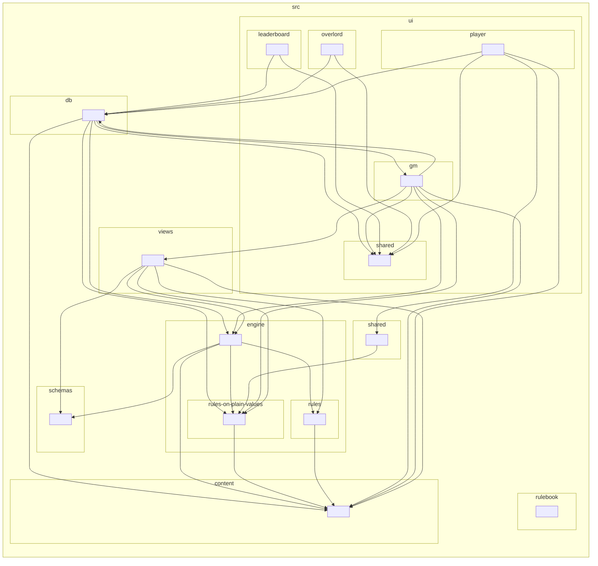

# Architecture

How Kingdoms Call works today, at the cutover build (GM portal `2026.09.30-0038`, data file
`2026.09.29-2329`). Short on purpose: read this, then [traps.md](traps.md), then only the code you need.
Line numbers drift; search for the names given here.

## The shape in one paragraph

A static site with no server of its own. Every published page is an HTML file and its one script and one stylesheet
(`assets/<page>-<hash>.js`, `assets/<page>-<hash>.css`), built by Vite from the ES modules in `src/`
([below](architecture/the-build-from-src-to-site.md#the-build-src-becomes-site)). The pages talk straight to a Supabase Postgres database from the browser, using
supabase-js and the project's public (anon) key. **The turn engine runs in the GM's browser tab**: the
GM portal generates worlds, runs the bots, resolves turns and writes each realm's report. Players only
submit orders and read what they're given.

## The build: `src/` becomes `site/`

Moved to [the-build-from-src-to-site.md](architecture/the-build-from-src-to-site.md).

## The layers and the module map

Which folder of `src/` may import which is checked by dependency-cruiser (P1-13a): `npm run lint:arch`, in CI's static
job and in `npm run check`, with its rules in `.dependency-cruiser.mts`, every one an error.

- **`content/`** (the data file) imports nothing.
- **`engine/`** imports only `engine/` and `content/`; **`engine/rules-on-plain-values/`**, the rules the player portal
  shares, only itself and `content/`.
- **`engine/rules/`**, the rule registry ([below](architecture/the-rule-registry-and-the-one-source-for-shared-rules.md#the-rule-registry)), imports only itself,
  `engine/rules-on-plain-values/` and `content/`: an effect reaches the dice, the turn's state or a report only through
  what its stage hands it (P1-19a).
- **`views/`** imports only `views/`, `engine/` and `content/`; **`shared/`** only `shared/`, `views/`,
  `engine/rules-on-plain-values/` and `content/`.
- **`schemas/`** holds the world's types: any folder may import it with `import type` (TypeScript erases it), and none
  another way but the save's upgrade (`engine/saves/upgrade-a-saved-game-and-check-it.ts`), whose check at load
  parses with it (P1-15d).
- **`db/`** imports only `db/` and `schemas/`, and only the pages' code (`ui/`) imports `db/`. Only `db/` may import
  `@supabase/supabase-js` (none does until P1-17: the pages read the copy served with the site).
- **A page's code** (`ui/<page>/`) imports no other page's but `ui/shared/`, which imports only itself. **Only the GM
  page imports the engine** (it runs the turn and edits the world); the player portal, the Hall of Fame and the
  Overlord page reach it only through `shared/` and `views/`.
- **No cycle through imports that bring code**: a cycle of `import type` only is let through. Every import resolves.

**What broke a rule when the rules came in** is listed in `.dependency-cruiser-known-violations.json` (105 findings)
and let through (`--ignore-known`): `db/`'s 14 imports outside itself (P1-17's access layer), and the 91 findings of the two
import cycles left, the GM page's (10 files, both of `db/` among them) and the player page's (18). P1-13e broke the
engine's six cycles by moving code, one cycle a pull request: P1-13e1 the four two-file cycles in one, P1-13e2 the
core, and P1-13e3 to P1-13e5 the bots' cycle in three steps. **The engine has no import cycle now**, and the no-cycle
rule keeps it so; the pages' two come later (the GM page's after P1-17 takes `db/`'s page code out, the player page's
after P1-11b). The ratchet counts the list
(`knownArchitectureViolations`), so it only shrinks, and a static test fails while it holds a finding that no longer
occurs: when you fix one, remove it in the same pull request with
`npx depcruise src --baseline --baseline-mode shrink-only`. Never add a finding to it. A cut that leaves part of a
cycle may make dependency-cruiser report some of the findings that stay along another path, which shrink-only mode
can't follow. (dependency-cruiser reports a cycle once, along one path, and matches a known one by its set of files.)
Then rewrite the list with `npx depcruise src --baseline`, check that every entry it adds is a cycle among the files
still in the cycle and that every import on it was there before, and name in the pull request any import the cut adds
inside the cycle (P1-13e3: 19 removed, 7 re-described; P1-13e4: 15 removed, 5 added, two of them on the two imports the
cut adds into `bots/strategy.ts`, the bots' shared base). A cut that ends a cycle needs only shrink-only mode (P1-13e5:
14 removed, none added).

**Unused code** is knip's (`npm run knip`, `knip.ts`): files nothing imports, exports nothing reads (an export read in
its own file counts as used) and dependencies nothing uses, from the pages' real entries. Today it finds 29 (15 exports
nothing calls, which P1-23 removes, and 14 exported types of `schemas/` nothing reads yet), counted by the ratchet
(`unusedCode`), so it only falls.

**The module map**, generated from the imports by dependency-cruiser (one box a folder; an arrow is an import, `import
type` included). `tests/static/the-module-map-in-architecture-md-is-generated-from-the-imports.test.ts` fails when it
differs from the code; rewrite it with `npx tsx tools/module-map.ts --write`.

<!-- The module map: generated from the imports by npx tsx tools/module-map.ts --write. Don't edit it by hand. -->

<!-- End of the module map. -->

## The rule registry

Moved to [the-rule-registry-and-the-one-source-for-shared-rules.md](architecture/the-rule-registry-and-the-one-source-for-shared-rules.md).

## A saved game: its version, its upgrade, its check

Moved to [a-saved-game-its-version-its-upgrade-its-check.md](architecture/a-saved-game-its-version-its-upgrade-its-check.md).

## The pages (`site/`)

Moved to [the-pages-how-a-portal-boots-and-how-a-page-builds-html.md](architecture/the-pages-how-a-portal-boots-and-how-a-page-builds-html.md).

## How a portal boots

Moved to [the-pages-how-a-portal-boots-and-how-a-page-builds-html.md](architecture/the-pages-how-a-portal-boots-and-how-a-page-builds-html.md).

## How a page builds HTML

Moved to [the-pages-how-a-portal-boots-and-how-a-page-builds-html.md](architecture/the-pages-how-a-portal-boots-and-how-a-page-builds-html.md).

## `kingdoms-call-data.ts`: the one source for shared rules

Moved to [the-rule-registry-and-the-one-source-for-shared-rules.md](architecture/the-rule-registry-and-the-one-source-for-shared-rules.md).

## The turn engine (GM portal)

Moved to [the-turn-engine.md](architecture/the-turn-engine.md).

## The database (Supabase)

Moved to [the-database-and-what-it-holds.md](architecture/the-database-and-what-it-holds.md).

## Hall of Fame

Moved to [the-database-and-what-it-holds.md](architecture/the-database-and-what-it-holds.md).

## Dispatches (player messaging)

Moved to [the-database-and-what-it-holds.md](architecture/the-database-and-what-it-holds.md).

## Versions

Moved to [the-database-and-what-it-holds.md](architecture/the-database-and-what-it-holds.md).

## Staging

Moved to [the-database-and-what-it-holds.md](architecture/the-database-and-what-it-holds.md).

## Tests

Moved to [the-toolchain-the-checks-and-the-harness.md](architecture/the-toolchain-the-checks-and-the-harness.md).
