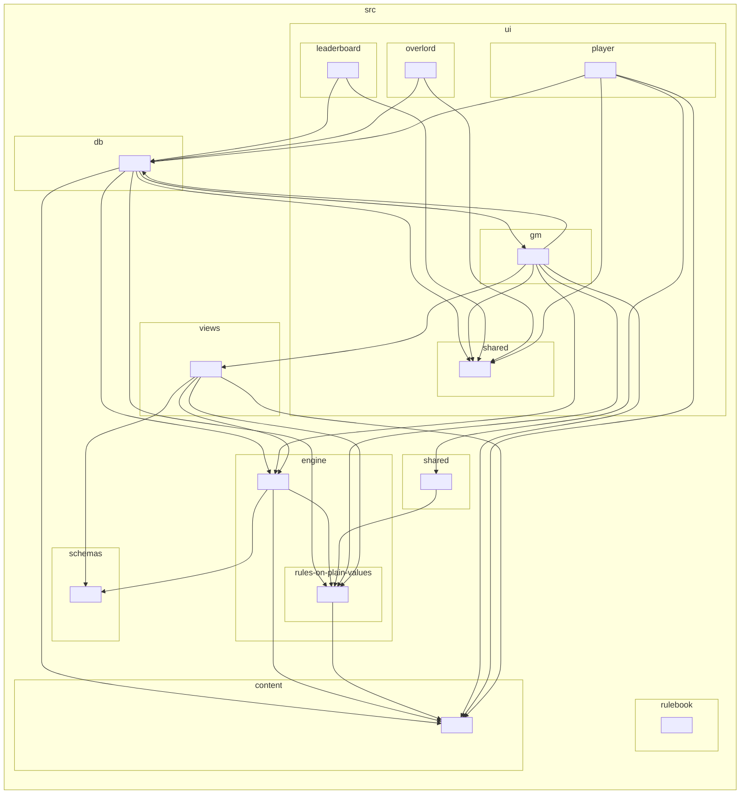

# Architecture

How Kingdoms Call works today, at the cutover build (GM portal `2026.09.30-0038`, data file
`2026.09.29-2329`). Short on purpose: read this, then [traps.md](traps.md), then only the code you need.
Line numbers drift; search for the names given here.

## The shape in one paragraph

A static site with no server of its own. Every published page is an HTML file and its one script and one stylesheet
(`assets/<page>-<hash>.js`, `assets/<page>-<hash>.css`), built by Vite from the ES modules in `src/`
([below](#the-build-src-becomes-site)). The pages talk straight to a Supabase Postgres database from the browser, using
supabase-js and the project's public (anon) key. **The turn engine runs in the GM's browser tab**: the
GM portal generates worlds, runs the bots, resolves turns and writes each realm's report. Players only
submit orders and read what they're given.

## The build: `src/` becomes `site/`

Since P1-05, `src/` is the source and `site/` is build output: git-ignored, published by the deploy, and opened by
every test. **Edit `src/` (or `public/`), never `site/`**: the next build overwrites it. Since P1-09d the site's code is
ES modules, built by Vite; since P1-09e every file is TypeScript (`.ts`).

- **`npm run build`** (`tools/build.ts`, a few seconds) runs Vite once per page (P1-09's Decision 8). Every
  `src/*.html` is a page (`index.html`, both portals, the Hall of Fame, the Overlord page, both rulebooks). Vite
  follows each page's `<script type="module" src>` through every `import`, and writes one script holding the page's
  code, with no `import` left (`assets/<page>-<hash>.js`), and its stylesheet (`assets/<page>-<hash>.css`). Built one page at a time,
  each bundle stands alone, which is what lets a test run it as a classic script in jsdom. `public/` is copied as it
  is: `kc-config.js`, `kc-staging-footer.js`, `vendor/`.
- **The options**, in `tools/build.ts` (one place, for the build and for `npm run dev`): no minifying (a live error's
  stack keeps the code's names), `target: 'esnext'` and no module preload (the code is left as written, nothing is
  added), relative paths (`base: './'`), and names with a hash of the file's content (P1-06b): a change to a page's code
  or stylesheet gives that file a new name, and an unchanged file keeps its own, so a browser keeps its cached copy.
  Two builds of the same `src/` are byte-identical (`pages-build`), names and all, when run from the folder that holds
  `src/`: Rolldown names each module in a bundle (`//#region src/…`) from the folder it runs in. Constants are not written
  in where they are read (Rolldown's `inlineConst` is off), so every constant keeps its name. Rolldown, Vite's bundler,
  still leaves out a function or constant nothing reaches, writes each top-level `const`, `let` and `class` as a `var`,
  and lays the code out its own way. It strips the types from the `.ts` files with the settings of `tsconfig.json`,
  some of which change the code it writes (`useDefineForClassFields`, for one): so `tsconfig.json` is an engine path
  (the balance matrix plays a change to it). The rename to `.ts` (P1-09e) changed no byte of any page but the
  `//#region src/….ts` comment Rolldown writes before each module.
- **Each page's entry is `src/ui/<page>/page.ts`** (the rulebooks': `src/rulebook/toc.ts`). It imports the page's
  files in the order they ran as classic scripts, `globals.ts` last. Each file imports by name what it reads from
  another (generated by P1-09d's codemod, then kept by hand); ES modules run each file after the files it imports, so
  a constant read as a file loads can't be read before its line has run, unless two files import each other
  ([traps.md](traps.md#a-constant-read-at-load-time-must-live-in-a-leaf-module)). No new cycle may appear; the eight
  known are listed in a baseline ([below](#the-layers-and-the-module-map)). Which files make a page is read the same way by `tools/pages.ts`, for the tests and the
  balance runner; `tests/static/pages-build.test.ts` checks it names what Vite's build holds, and that every file
  under `src/` is in some page.
- **Folders say what most of a file is**: `engine/` (rules, bots, world generation; `engine/sight/`, the sight rules
  the engine asks as it resolves and the report applies, P1-12b1), `views/` (every realm's turn report, the lines each realm reads: `playerEvents`, P1-12b3, and what it may see of the world: `playerView`, P1-12b4 and P1-12b5, from which alone the report is built), `db/` (the version guard, telemetry and the light `meta` rows),
  `content/` (the data file), `shared/` (the player portal's one door to the engine: it re-exports the rules of
  `engine/rules-on-plain-values/` the portal calls, and nothing else; [below](#kingdoms-call-datats-the-one-source-for-shared-rules)),
  `schemas/` (the types of the world, from Zod schemas: below), `ui/<page>/` (each page's styles,
  its entry and the rest of its code), `ui/shared/` (`kc-safe.ts`), `rulebook/`. The
  templates are at the top of `src/`. The GM portal's code is 141 modules; `src/engine/run-turn.ts` (the turn,
  `resolveTurn`, once ~13,000 lines, now ~240) was taken apart by P1-08, one area at a time (below). The player portal's
  is 35: its own 23, the data file, `kc-safe.ts`, `kc-db-guard.ts`, `src/shared/`'s file and the folder's eight.
- **TypeScript checks the site** (`tsconfig.json` includes `src/`, with the browser's types; one project until P1-10
  splits the engine's). The files that were JavaScript start with `// @ts-nocheck` and the reason (142 of 158 at the
  rename: strict TypeScript found errors in each); P1-10 and P1-16 type them, and the ratchet's `tsNocheck` only falls.
  A new file is checked from the start. `src/globals.d.ts` declares what the modules read without importing it:
  `KC_CONFIG` and `supabase` (the pages' classic scripts), `KC_RNG_SEED` (the tests' seed) and each page's declared
  globals (`tests/static/globals-d-ts.test.ts` checks it names exactly those). No file of `src/` may claim what the
  compiler can't check: a type assertion (`x as T`; `as const` is fine) or a non-null assertion (`x!`) is a lint error
  (P1-10a1). The three assertions P1-11a3 wrote before the rule are let through, one in each of its files
  (`eslint.config.js`, `TYPE_ASSERTIONS_KEPT`, which `tests/static/harness.test.ts` checks only shrinks); P1-10b
  replaces them with checks.
- **The types of the world come from Zod schemas, in `src/schemas/`**
  (P1-10a1): the saved game state (`saved-game-state.ts`: `GameState`, `Realm`, `Character`, `Army`, `Item`,
  `Province`, `Grave`, `Mercenary`, and the shapes they share), the orders a realm submits (`orders-a-realm-submits.ts`:
  `OrdersARealmSubmits`, `PhaseOrder`, `EncounterPlan`) and the branded ids (`ids-of-provinces-heroes-and-realms.ts`:
  `ProvinceId`, `CharacterId`, `RealmIndex`, so a hero's id can't be passed as a province's). Each type is
  `z.infer` of its schema, so one definition types the code now and later checks a save at load (P1-15) and a database
  row (P1-17). They are on today's shape, written from the balance matrix's 2,687 saved states and tidied by hand: a
  field only some code reads is added when the file that reads it is typed (P1-10a3, P1-10b). `src/` imports them as
  types only (`import type`) until P1-15, so no page's bundle holds them or Zod; `pages-build` refuses a value import.
  Their objects are `z.object`, which drops a key it doesn't name; the tests parse strictly
  (`tests/lib/strict-schema.ts`), and `tests/unit/the-saved-game-state-schemas-parse-every-state-of-a-matrix-game.test.ts`
  parses a whole matrix game's states and orders. They type the 14 files of the engine's side that pass strict
  TypeScript with annotations alone (P1-10a3: the dice, the routes, the ladder, the visibility rule, the battle report's
  lines and more; the list is in P1-10a3's pull request). The other 94 of those 108 files still say `@ts-nocheck`:
  each needs a statement changed to pass (a check for a value that may be missing, say), which P1-10b makes and the
  balance matrix proves ([traps.md](traps.md#ts-nocheck-checks-nothing-in-the-file)).
- **The content's and the engine's own types** (P1-10a2), types only, so no file the build makes changes with them:
  - **In the data file:** `UnitType` (the keys of `KC_UNIT_TYPE`), `PrimalUnitType`, `ElementalUnitType` and
    `HumanoidUnitType` (the rest); `Quality`, `Skill`, `MagicSchool`, `Alignment` and `HumanoidRace` (from its lists, each
    `as const`) and `Terrain`. Its tables keyed by unit type end in `satisfies` on the part each covers, so a unit
    left out of one fails to compile ([traps.md](traps.md#a-new-army-unit-is-a-dozen-tables);
    `tests/static/a-unit-left-out-of-a-data-table-fails-to-compile.test.ts`).
  - **In the engine:** `TurnContext`, the turn's context (every field `resolveTurn` adds), and `LogLine`, a line of
    the GM's log, in `engine/turn/context.ts`; `OrderKind`, the 48 kinds an order's action reads as, beside
    `PHASE_ACTION_MAP` (`engine/turn/phase-intents-and-dependency-ordering.ts`). Both files keep `@ts-nocheck`, and
    TypeScript checks nothing in a file with it, these types and the map's `satisfies` included: a file is checked
    against them once it loses `@ts-nocheck`. Since P1-10a3 the files freed of it are; where their reads disagreed with
    `TurnContext`, the type was corrected (a line's `targets` may hold null: callers pass `[c.player]`). Beside them in
    `context.ts`: `NarrativeLine` (a line of a battle's narrative, a string or a line for one realm alone) and
    `TurnOrder` (a hero's order for a phase as the turn holds it). The freed files declare a few shapes of their own
    (`LadderRow` in `battle/ladder.ts`, `SightContext` in
    `sight/heroes-in-sight-features-discovered-and-army-size-bands.ts`), and the schemas' file names a feature
    (`ProvinceFeature`) and the title keys (`MajorTitleKey`, `MinorTitleKey`).
  - `tools/pages.ts` reads a module's imports that bring code, so an `import type` (of `src/schemas/`, say) adds no file
    to a page.
- **The engine is `engine/` and `views/`** (P1-18c): nothing in them reads the screen, the database or the page's other
  globals, and every name they read is imported from them or the data file: P1-18d moved the last exceptions, the
  turn's database and screen work and the reports' build stamp, into the turn's shell (`ui/gm/turn-shell.ts`).
  `tests/lib/engine.ts` bundles them with Vite (the data file, then the two folders in the GM page's order:
  `engineEntryFiles()` in `tools/pages.ts`) and runs the bundle in a bare Node `vm`. The Hall of Fame's GM-side code
  reads the database and the screen, so it is `ui/gm/hall-of-fame.ts`.
- **A new file is imported where it is used**, and by the page's `page.ts` if it does something as it loads. A file
  no page reaches fails `pages-build`; an import of a file that isn't there stops the build.
- **Who builds:** `npm test` and `npx playwright test` before any test (`tests/setup/global.ts`; not when `KC_SITE`
  names another copy), `npm run balance` (and the base branch's copy, with that branch's own build:
  `tools/balance/sides.ts`), every CI job that tests, and the deploy and staging, each in a `build` job of its own
  (P1-06a). The deploy's `build` job runs just before the site is published, after production is migrated; staging's
  runs while the staging job waits for CI. Each installs the build's tools first (`npm ci --ignore-scripts`: without
  the packages' install scripts, which the build doesn't need), builds `site/`, and hands it on as an artifact. A
  `build` job may only read: no write permission, no environment, no secret. The job that publishes (`deploy`, with
  the Pages token; `staging`, with the staging secrets) downloads that artifact and runs no `npm` and no build; no job
  that can write, runs in an environment or reads a secret does (`tests/static/harness.test.ts` checks all of it).
- **A deploy keeps the files a cached page names** (P1-06b; [traps.md](traps.md#a-deploy-keeps-the-files-a-cached-page-names)).
  GitHub Pages replaces the whole site on each deploy, and its cache hands out a page for up to 10 minutes after it, so
  a page cached before a deploy can ask for a bundle the new site has renamed. Between the build and the upload, each
  `build` job runs `tools/deploy/keep-the-previous-deploys-files.ts` (plain Node, no install): it reads the previous
  site and puts back every file that site's pages name (scripts, stylesheets, `vendor/`, and the `url()`s in their
  stylesheets), and every file its `published-files.json` lists as live within the last 24 hours, that the new build
  lacks. A file the new build makes is never overwritten. It then writes the new `published-files.json`. The deploy
  reads the previous site from the newest Deploy run on `main` whose `deploy` job succeeded (a run can succeed with that
  job skipped, having published nothing): its `github-pages` artifact, exactly what it published (`actions: read`; kept 30 days). With no artifact (none yet, or expired: the last deploy is over 30 days
  old), it reads the live site over HTTPS. Staging reads its previous site from a shallow clone of the staging
  repository, which is public. Anything wrong (no previous site, a missing file, a failed request) stops the `build`
  job, so nothing is published and the site stays as it was (`tests/unit/a-deploy-keeps-the-files-a-cached-page-still-names.test.ts`,
  `tests/browser/a-page-opened-before-a-deploy-still-loads-its-files.spec.ts`). The site grows by about 1 to 3 MB a
  deploy while the old files are kept.
  Run `npm run build` yourself before opening a page or running one test script on its own.
- **`npm run dev`** (`tools/dev.ts`) serves the pages with Vite's dev server, against the local Supabase only: it serves
  `kc-config.js` from `public/dev/kc-config.js` (git-ignored, never published; `npm run dev -- config` writes it from
  `npx supabase status`), and refuses to start without one, or with one that names another database
  (`tests/unit/dev-server.test.ts`). Its pages' footers say "build dev".
- **Each page's version is filled in by the build** (P1-06c; [Versions](#versions)): the footer's build line and two
  metas, after Vite, and `version.json` beside the pages.

## The layers and the module map

Which folder of `src/` may import which is checked by dependency-cruiser (P1-13a): `npm run lint:arch`, in CI's static
job and in `npm run check`, with its rules in `.dependency-cruiser.mts`, every one an error.

- **`content/`** (the data file) imports nothing.
- **`engine/`** imports only `engine/` and `content/`; **`engine/rules-on-plain-values/`**, the rules the player portal
  shares, only itself and `content/`.
- **`views/`** imports only `views/`, `engine/` and `content/`; **`shared/`** only `shared/`, `views/`,
  `engine/rules-on-plain-values/` and `content/`.
- **`schemas/`** holds types only: any folder may import it with `import type` (TypeScript erases it), and none another
  way.
- **`db/`** imports only `db/` and `schemas/`, and only the pages' code (`ui/`) imports `db/`. Only `db/` may import
  `@supabase/supabase-js` (none does until P1-17: the pages read the copy served with the site).
- **A page's code** (`ui/<page>/`) imports no other page's but `ui/shared/`, which imports only itself. **Only the GM
  page imports the engine** (it runs the turn and edits the world); the player portal, the Hall of Fame and the
  Overlord page reach it only through `shared/` and `views/`.
- **No cycle through imports that bring code**: a cycle of `import type` only is let through. Every import resolves.

**What broke a rule when the rules came in** is listed in `.dependency-cruiser-known-violations.json` (141 findings)
and let through (`--ignore-known`): `db/`'s 14 imports outside itself (P1-17's access layer), and the 127 findings of the three
import cycles left (P1-13e breaks them by moving code, one cycle a pull request; P1-13e1 broke the engine's four
two-file cycles in one, P1-13e2 its core, and the bots' cycle takes three): one in the engine (the bots, 11 files), the GM
page's (10 files, both of `db/` among them) and the player page's (18). The ratchet counts the list
(`knownArchitectureViolations`), so it only shrinks, and a static test fails while it holds a finding that no longer
occurs: when you fix one, remove it in the same pull request with
`npx depcruise src --baseline --baseline-mode shrink-only`. Never add to it.

**Unused code** is knip's (`npm run knip`, `knip.ts`): files nothing imports, exports nothing reads (an export read in
its own file counts as used) and dependencies nothing uses, from the pages' real entries. Today it finds 29 (15 exports
nothing calls, which P1-23 removes, and 14 exported types of `schemas/` nothing reads yet), counted by the ratchet
(`unusedCode`), so it only falls.

**The module map**, generated from the imports by dependency-cruiser (one box a folder; an arrow is an import, `import
type` included). `tests/static/the-module-map-in-architecture-md-is-generated-from-the-imports.test.ts` fails when it
differs from the code; rewrite it with `npx tsx tools/module-map.ts --write`.

<!-- The module map: generated from the imports by npx tsx tools/module-map.ts --write. Don't edit it by hand. -->

<!-- End of the module map. -->

## The pages (`site/`)

Built from `src/` and `public/` ([above](#the-build-src-becomes-site)).

| File | Size | What it is |
|---|---|---|
| `index.html` | small | Landing page; links the player portal and both rulebooks. A stylesheet, no script of its own |
| `kingdoms-call-gm-portal.html` | ~300 lines; its bundle ~58,600 lines, ~2.0 MB | GM UI, world generation, the whole turn engine (`resolveTurn`, and its shell `runTurn`), bot AI, turn reports, telemetry, Stats tab, Hall-of-Fame builder, "missing from the database" messages |
| `kingdoms-call-player-portal.html` | ~450 lines; its bundle ~10,800 lines, ~560 KB (since P1-06c: without the start-up guard, it holds only the tables it reads) | Sign-in, My Games, order entry, the turn report and Chronicle, the map, Dispatches (player messaging). Calls the engine's rules of a hero, an army, an item or a number through `src/shared/` (it loads no other engine file); still holds client-side projections that mirror engine rules (see [traps.md](traps.md#a-rule-written-twice-must-change-twice)) |
| `kingdoms-call-leaderboard.html` | ~120 lines; its bundle ~1,200 | Hall of Fame: leaderboard and achievement records over finished games |
| `kingdoms-call-overlord.html` | ~110 lines; its bundle ~460 | The Overlord page (P0-32f): accounts (offer, withdraw and revoke GM; suspend, lift and delete: P0-32h), handing games to another GM, every game, every game's reported dispatches. For the Overlord only; not linked from any page. Its sign-in is kept apart from the portals' (its own `storageKey`). No data file |
| `kingdoms-call-rules.html`, `kingdoms-call-rules-intro.html` | | The comprehensive and introductory rulebooks (prose); their script opens and closes the table of contents |
| `assets/<page>-<hash>.js`, `assets/<page>-<hash>.css` | | Each page's bundle and stylesheet, named by a hash of its content (P1-06b). The data file (`src/content/kingdoms-call-data.ts`), `kc-safe.ts` and `kc-db-guard.ts` are inside the bundles of the pages that use them, no longer files of their own. Older ones, which a cached page may still name, are kept for 24 hours after they stop being live ([above](#the-build-src-becomes-site)) |
| `kc-config.js`, `kc-staging-footer.js` | small | Copied as they are from `public/`: which database this copy talks to (staging writes its own), and staging's footer |
| `vendor/supabase-js-<version>.min.js` | ~210 KB | The Supabase library, a copy served with the site ([below](#supabase-js-a-copy-served-with-the-site)) |
| `version.json` | small | Written by the build: the commit and each page's fingerprint, which open pages read ([below](#versions)) |
| `published-files.json` | small | Written by the deploy, not the build: every file of the site and when it stopped being live (`null` while it is). The next deploy reads it to know what to keep: never rename it |

All pages sit in one folder and link each other relatively. Only `site/` is published, so URLs are the
same as before the cutover and the build. No page loads a script from another site; the only outside requests are
Google Fonts.

### supabase-js: a copy served with the site

The pages load supabase-js from `vendor/` beside them (source: `public/vendor/`, copied as it is), not from a CDN
(P0-18), so no outside party can change the code that holds players' logins, and a CDN outage can't stop the portals
loading.

- **Version:** 2.117.3, the package's browser build (`dist/umd/supabase.js`) copied unchanged to
  `public/vendor/supabase-js-2.117.3.min.js`, with its licence beside it (`supabase-js-LICENSE.txt`).
- **SHA-256:** `d6a5c4414a5d4ce646d9c1de223aa7067d3ff664c15394ffeb7fcffc763354a3`. `npm test`'s
  `vendor-supabase` check fails if the file and this line disagree.
- **Nothing watches it for updates** (Dependabot can't see a copied file). When you touch this area, check
  `npm view @supabase/supabase-js@2 version` and upgrade if it's newer. P1-17 replaces the copy with a pinned
  npm dependency.

**To upgrade**, in its own PR (it changes `public/vendor/**`, so it's a dangerous path: talk it through with
Theo):
1. In an empty folder: `npm pack @supabase/supabase-js@<version>` (npm checks the download against the
   registry's checksum), then unpack it with `tar -xzf`.
2. Copy `package/dist/umd/supabase.js` to `public/vendor/supabase-js-<version>.min.js` and `package/LICENSE` to
   `public/vendor/supabase-js-LICENSE.txt`; delete the old copy.
3. Point the `<script src="vendor/…">` tags (in the page templates, `src/*.html`) and their boot-failure hints
   at the new file name, and update the version and SHA-256 above (`shasum -a 256 <file>`).
4. Read the release notes between the two versions for anything the pages use (sign-in, `rpc`, realtime).
5. `npm test`, then try sign-in, orders and Dispatches on staging.

## How a portal boots

Order inside each portal's page, and why it matters:

1. **Boot-failure reporter**: a small inline script, first in `<head>` (in the template itself). While the loading
   spinner is still showing, the first `error` or `unhandledrejection` replaces it with the message, a hint and a
   Reload button. Without it, any throw as the page starts looks like "Loading…" for ever. It puts the message and
   hint in as text, since it runs before the HTML helpers exist.
2. **supabase-js v2**, from the site itself (`vendor/supabase-js-<version>.min.js`, [above](#supabase-js-a-copy-served-with-the-site)).
3. **`kc-config.js`**, at the end of `<body>`: `KC_CONFIG`, which database this copy of the site talks to (address and
   public key). Every page that uses the database loads it; a staging copy of the site replaces only this file.
4. **`kc-staging-footer.js`**, last in `<body>` (every page). On staging it adds "Staging · PR #N · abc1234" to the
   footer, plus "database <version>" on pages that use the database; on the live site, whose `kc-config.js` has no
   `deployed`, it does nothing.
5. **The page's bundle** (`assets/<page>-<hash>.js`). A module script runs once the whole page is parsed, after the classic
   scripts above, in strict mode, wherever its tag is (Vite puts it in `<head>`). Its files run in its entry's order,
   each after the files it imports: `kc-safe.ts` first (the HTML helpers, [below](#how-a-page-builds-html)), then
   `kc-db-guard.ts` (`kcDbGuard`, the database version guard,
   [traps.md](traps.md#a-site-change-that-needs-a-database-change)), the data file (both portals), then the page's own
   code. The start-up file creates the Supabase client, then
   `kcDbGuard(sb, KC_DB_MIN)`: only if the database is at least `KC_DB_MIN` does it call `init()` (the leaderboard:
   `loadAll()`), which hides the spinner. Otherwise the guard raises "The game is being updated" through the
   boot-failure reporter, and nothing is read or written. In the GM portal, a signed-in account is then checked
   (`gmPortalAllowed`: `is_game_master()` or `is_site_admin()`, P0-32c); anyone else, or a check that fails, sees only
   "You're not a Game Master" and nothing else loads. The Overlord gets **Master GM mode** (`_kcOverlord`, P0-32g):
   every game, grouped by GM, with no New Game and no automatic watcher; **Run turn now** on any active game, orders
   in or not; `?game=<id>` (the Overlord page's link) opens a game.

**Nothing is on `window` but what `globals.ts` puts there.** A module's top-level names are its own, so an inline
`on…="…"` handler or a browser spec's `page.evaluate` can't reach them. Each script page's entry ends with
`ui/<page>/globals.ts` (P1-09b): two `Object.assign(window, { … })` lists, the names the page's inline handlers call
and the names its tests reach. A variable the page's files or its tests share is a declared global instead,
`globalThis.<name> = <value>;` where it is declared (a list's copy of a variable goes stale). `npm test`'s
`page-globals` keeps the lists exact ([traps.md](traps.md#nothing-is-on-window-but-globalsts)). The classic scripts
(`kc-config.js`, the footer, the reporter) still share the browser's one global scope: `KC_CONFIG` is read by name.

## How a page builds HTML

Every name and message on screen was typed by someone, so a page treats every value as text (P0-19).
`kc-safe.ts` (`src/ui/shared/kc-safe.ts`) gives each page four helpers:

- **`kcHtml`**, a tagged template: in ``kcHtml`<td>${realm}</td>` `` every value is escaped, unless it is itself
  `kcHtml` or `kcRaw`. A list is its items, one after another. It returns a marked value that goes into
  `innerHTML` as markup.
- **`kcEsc(v)`**: `v` as text, for the rare place that needs a plain escaped string.
- **`kcArg(v)`**: a value inside an `on…="…"` handler, e.g. ``kcHtml`<tr onclick="toggleGame(${kcArg(id)})">` ``. The
  browser unescapes an attribute before running it, so escaping alone isn't enough there.
- **`kcRaw(s)`**: markup passed through unchanged. Only for markup no player can have written; each use says why.

Engine narrative is escaped where it's shown, not where it's written: the report stores `**bold**`, and the page
turns it into `<strong>` after escaping. The player portal's Chronicle also tints each name it knows: it splits the
line's text at every bold run and every name, and wraps only those pieces in `kcHtml`, so the rest stays text. A
list of `kcHtml` pieces with a separator between them goes in through the player portal's `kcJoinP(list, sep)`. A
page whose content is mostly fixed builds elements instead (the Overlord page's `el()`), which is just as safe.

Every page builds its HTML this way. The lint rule `kc/html-is-built-only-through-kc-html` (`tools/eslint-rules/`,
P1-13d) refuses HTML built any other way, in the editor, in `npm run lint` and in CI, and each page that builds HTML
from data has a hostile-name test. Its reviewed exceptions are `HTML_EXCEPTIONS` in `eslint.config.js`, each with its
reason; one that matches nothing is itself a finding. Mistakes to avoid: [traps.md](traps.md#html-is-built-only-through-kchtml).

## `kingdoms-call-data.ts`: the one source for shared rules

`src/content/kingdoms-call-data.ts`, a module every table of which is exported and imported by name where it is read
(P1-09's Decision 4). Since P1-09d it is bundled into each portal's script, not published as a file of its own.

- **Content tables** (`ALL_MAGIC_ITEMS_P`, `MONSTERS_P`, `PRIMAL_ARMY_DEFS_P`, `MASTERY_UNLOCKS`, …):
  plain literals. Nothing in the file may reference portal code. `PRIMAL_ARMY_DEFS_P` is the one place a
  Creature's or Monster's cost, strength, move, sub-race and pre-battle strike are written; the GM master
  tables and the player portal's speeds are built from it, and `tests/lib/primal-decided.js` (the wild roster
  Toby decided on 2026-10-13) holds it, the class lists, the Druid ladder and the books to the decided figures.
- **Shared rule tables** (the block headed `SHARED RULE TABLES`): every `KC_*` table, e.g.
  `KC_UNIT_CLASS` (unit classes as ordered lists), `KC_UNIT_TYPE` (each unit's one type word: infantry,
  ranged, cavalry, flyer or naval), `KC_DRUID_LEVELS`, `KC_UNIT_BASE_STR`, `KC_SKILLS`,
  `KC_SEASONS`, `KC_GRAND_DESIGNS`. Until 27 Sept each lived in two to eleven hand-typed copies,
  several of which had drifted. Now each portal builds its own local copy **from** these
  (`new Set(KC_UNIT_CLASS.creature)`, `KC_SEASONS.slice()`, `{...KC_SKILL_LABELS}`), so no consumer can
  mutate another's. The editing rules are at the top of that block: change a rule there; append, never
  re-sort; plain data only; `KC_` names only.
- **Shared rule functions** (P1-11a): a rule of a hero, an army, an item, a level or a number that both portals need
  is written once, in `src/engine/rules-on-plain-values/` (its files import only the data file and each other), and the
  player portal imports it by the engine's name through `src/shared/the-engines-rules-the-player-portal-shares.ts`,
  which re-exports only from that folder: e.g. `dispFloor`, `unitBaseStrength`, `itemSlot`, `heroHireWage`,
  `getFlyCapability`, the two casting limits. So the player page loads no other engine file and runs none of the
  engine's set-up as it loads. `tests/static/the-player-portal-reaches-the-engine-only-through-src-shared.test.ts`
  refuses a portal file that imports an engine or a views file, or declares one of the retired copies (`floorNumP`, …)
  or a name `src/shared/` hands it. The portal's copies still left (they read the report's shape: P1-11b) are the
  ones `tests/lib/player-portal-copies.ts` checks.
- **A few deliberate near-copies stay in the GM portal**, because the *order* is a tie-break priority
  (each is commented `NOT a copy`). Don't collapse them.

**No stamp, no guard** (since P1-06c). The data file is bundled into each page that uses it, so it can't be missing
or older than the page, and a table a page imports that the data file lacks stops the build. Its stamps and the two
portals' start-up guards are gone.

## The turn engine (GM portal)

- **Game state** is one JSON value per game in `games.game_state` (hundreds of KB for a mid-game
  6-realm world). It arrives from Supabase as a **string**: always read it through
  `parseGameState(game)`.
- **Turn 0.** `runTurn0` previews the bot roster; `commitTurn0` generates the world, saves it and
  pushes each realm's first report.
- **A turn is two functions** (P1-18d): the engine works it out, and a shell around it does the database and
  screen work.
- **`resolveTurn(G, freshPlayers, expectedTurnToRun, seed)`** (`src/engine/run-turn.ts`) is the turn itself. It takes
  the saved state as loaded (JSON: parsing it is the turn's copy), the slot rows, the turn being run and the turn's
  seed (P1-08m). It
  brings an older save up to the current tables ([traps.md](traps.md#live-saves-keep-copies)), merges the
  orders, runs the bot passes, defaults missing orders to Defend, and resolves the five phases (look for
  `// 4. Run all 5 phases`) and the end of the turn. It is synchronous and reads no database, no screen and
  no clock; its dice are the seed's (below), or, given no seed, the dice in use (as a test fixes them). It returns
  `{state, log, spyStealthAndInvisibilityStampedForTheReports, whatTheReportsRead}`: the world to save, as JSON; the
  GM's log; the Spy-stealth step, which rolls each hero's Spy stealth and carries this turn's Invisibility into the
  reports' turn, on the working copy, once, on the turn's dice (P1-12b2); and `whatTheReportsRead()`, which hands over,
  once, after the stealth step, what the reports are built from: the slot rows, the working copy, the turn's log, the
  turn's sight (whose heroes stood where in each phase, who fought in each battle, whom each realm watches by
  Clairvoyance) and the telemetry's collectors (P1-12b3). Both are called only after the save. The engine imports no
  view: the reports are the views' (below). `tests/unit/engine-purity.test.ts` plays a whole game through it in Node,
  with no page.
- **Every realm's report** is built in `src/views/every-realms-report-and-the-lines-each-realm-reads.ts` (P1-12b3):
  `buildReports(whatTheReportsRead)` works out, for each played slot, the lines the realm reads and what it may see of
  the world, and builds its report from those two alone: **perception** comes first, in two functions, and the report
  reads nothing else (P1-12b5). `playerEvents(turnLog, G, realm, sight)` works out the lines: its own deeds, the lines
  sent to it or about its heroes, the world's announcements and what happened where it had eyes at the time, unmet
  realms left nameless, its spies' lingering sight and its Clairvoyance feed. `playerView(G, realm, itsLines)`
  (`views/what-each-realm-may-see-of-the-world.ts`, P1-12b4 and P1-12b5) is what the realm may see of the world, with
  the sight rules applied in that one place: the realm itself, the map's grid, and each province as it sees it (its
  own, a hero of its own there, spied, next to a spied one, next to its land, once visited, next to one it holds or
  visited, remembered, or not at all), with only what that sight shows, the features it knows and the heroes it sees
  there; its own heroes whole; the other heroes it sees (by the map's sight rule) and those beside its own; the dead
  it knows of; the mercenaries where it sees; the realms (named once met); the titles, worked out from the whole world
  and public from turn 5; its books (what its tax forecast and wages need of the world); and the player portal's
  lookup tables of every name's colour, untrimmed until P2-06. A figure that needs the whole world (a title, the
  discoveries' tax gold, a Wonder's blessing) is worked out there, by the engine's own function. Then
  `buildTurnReport(view, itsLines)` (`views/turn-report.ts`) builds the report from the view, and from the lines its
  chronicle, battle markers, province intelligence, spy activity and province events; it takes no state, so lint's
  `no-undef` refuses a read of the world there. Turn 0 and the tests' staged worlds build it from the view alone
  (`buildTurnReport(playerView(state, realm))`). They write nothing and draw no dice
  ([traps.md](traps.md#views-never-write)).
- **`runTurn`**, the turn's shell (`src/ui/gm/turn-shell.ts`), loads the full world and every slot, checks the
  game is still on the turn the GM meant to run, then **clears the submitted orders in the database**
  (keeping a copy in memory) and stops if that fails. Only then does it draw the turn's seed and call `resolveTurn`.
  Then it:
  1. **saves the world with a conditional update** (`.eq('turn', n)`), stamped with when the turn ran
     (`turnRanAt`, and in deadline mode `nextDeadlineAt`): if another tab already resolved this turn, nothing
     is written and `_saveConflict` is set;
  2. sets `_turnCommitted=true` on the line after that save succeeds;
  3. calls the Spy-stealth step, then the views' `buildReports(resolved.whatTheReportsRead())`, and writes each realm's
     report, stamped with the build that
     wrote it (`engineStamp`), and its `turn_logs` snapshot, then the GM's log (with the stealth step's lines at its
     end), then telemetry.

  Steps 2–3 are **post-commit**: a failure there must never restore orders or retry the turn
  ([traps.md](traps.md#post-commit-work-in-runturn)). Everything from the load to the save is in one `try`
  (P1-18a), so `runTurn` **returns** an outcome `{ok, committed, conflict, error}` on every path; it doesn't
  throw. A failure before the save puts the orders back as they were loaded. A save that answers with an
  error may still have landed, so the catch reads the game's turn again first: if it has moved on, the turn
  counts as committed and the orders stay spent; if it can't be read, nothing is put back.
  `tests/page/turn-shell.test.ts` stages each of these failures.
- **Automatic turns.** While a GM tab is open, `autoTurnTick` runs every 60 s (`AUTO_WATCH_MS`). Never in the
  Overlord's tab (Master GM mode, P0-32g): each game's own GM tab runs its automatic turns. For
  each live, non-archived game in automatic mode it checks whether all orders are in or the deadline
  has passed, and if so runs `runTurn`. A failed run parks that game for 15 minutes
  (`_autoFailUntil`, `AUTO_FAIL_COOLDOWN_MS`). This cooldown is per tab and in memory; the conditional
  save is what prevents a double resolution (a `localStorage` lease, `_autoLease`, also keeps two tabs in
  one browser from trying at once). Before running a due turn, the watcher reads `version.json` afresh
  and reloads the tab once (per game and turn) if it names another fingerprint for the GM page, first seen
  at least 10 minutes before, so the newest engine resolves it (`refreshIfNewerBuild`, [Versions](#versions)).
- **Bots** plan their orders inside `resolveTurn`, in the same tab, from the same state a human saw.
- **Battle lines** (`battleGrid` and its helpers, module level beside the strength ladder). The front the
  ground allows is rolled once per battle (`rollBattleWidth`: plains and desert 6–8, forest and jungle 4–6,
  mountain 2–4, sea 8–10); each side is placed by unit type into flanks, front, second line and reserve;
  `battleDeploy` lets the better-explored side (`battleScout`; a province's own defenders know it fully, ties
  to the defender) take the roll or one either side and line up second, then gives each commander one swap
  per Tactical level (`battleBestSwap`, every swap judged with both sides faced, and none that would part the
  two fronts: `battleFrontsMeet`); `battleFacing` reads the two
  grids against each other (matchups by unit type, wrapping, flank duels and guards, a turned flank) and its
  totals are the strengths the dice see. The units' own abilities sit on the same grid: `abilityFront` and
  `abilityBack` adjust one matchup, `battleFaceSide` the cases that read the whole line, `battleGrid` who may
  take a flank; the volley helpers (`missileDamageMult`, `abilityVolleys`, `missileTargetPool`,
  `archeryBlockedBy`) and `unitAbilityMult` carry the rest ([traps.md](traps.md#a-unit-ability-is-written-in-four-places)). Both battle paths score through deploy and facing, the stay-or-retreat
  estimate through grid and facing; the bots' estimates (`battleLineTotal`, at the middle width) through the
  grid alone. The report prints the grid as 📊 lines, which the portals draw in
  monospace, and the ladder names every place and matchup.
- **Unit fates** (`rollUnitFates`, module level beside `disbandLine`). After a battle, each unit of a player's
  force rolls once for its fate (a beaten survivor twice); the four casualty sections (the attacker winning or
  losing against a province's guard, a realm battle's winner and loser) all call it, passing their own
  thresholds and verbs, and a test passes its own dice. Each line names whom the company fought
  (`battleFacedClauses`, a map read from the deploy's grids right after the deploy, before the stay-or-retreat
  estimate faces the survivors afresh); the losses tally (`battleTallyLine`) reads a line's owner and unit
  type from the company named first in it, which is always the company's own reference.
- **Dice and the clock** (P1-07). Every random number the GM portal's code draws (dice, shuffles, bot choices, the
  world map, id suffixes) comes from `kcRng()` (`src/engine/rng.ts`): one sfc32 generator, the first file of the
  page's main script, seeded once per page load from `crypto.getRandomValues`, or from the seed a test gives the page.
  Since P1-18d nothing in the engine or its views reads the clock: only the turn's shell does, through `kcClock()`
  (`src/engine/clock.ts`, `Date.now()` when called), to stamp when the turn ran; the screens read `Date` as before.
  Lint keeps `Math.random` and `Date` out of the source (P1-13c, below), and `engine-purity` checks that a whole game
  reads neither ([traps.md](traps.md#dice-come-from-kcrng)). Each turn plays from its own seed (P1-18e): the shell
  (`runTurn`) draws a 32-bit integer from the page's dice, hands it to `resolveTurn`, and returns it (`{…, seed}`), for
  P2-01 to record. Since P1-08m the turn takes its seed: `resolveTurn` makes the dice of it (`kcRngStream(seed)`)
  once, lends them to itself (`kcRng.use`) and again to the Spy-stealth step, whose rolls carry on from the turn's, and
  gives back the dice in use before after each, also when it throws, so they are never lent across the
  shell's `await`s (P1-18e had the shell lend them; `tests/unit/the-turns-own-dice-from-its-seed.test.ts`). A mercenary
  band made in a turn gets its id from `newMercId()` in `resolveTurn`: `merc_t<turn>_<n>`, counted afresh each turn,
  with no dice or clock in it (P1-18b).
- **Engine functions are lifted out of `resolveTurn` one area at a time** (P1-08, done in P1-08n). It is the save's
  parse and upgrades, the turn's context and its start values, the stages' calls, the phase loop calling its stages and
  the reports: no rule of the game is written in it. No test reaches inside it by a source line any more (P1-09a): a
  test stands a top-level function in, in the engine's bare vm, or reads `src/` by its syntax tree
  ([traps.md](traps.md#string-anchor-harness-hooks)). A lifted helper that reads the turn's state takes **the
  turn's context** first: `turnContext`, made by `createTurnContext(G, freshPlayers, expectedTurnToRun)`
  (`src/engine/turn/context.ts`, whose `TurnContext` is its type since P1-10a2) just after the save is parsed. It holds the state and the GM's log (`turnLog`, which only `emit` writes, since P1-12a2: every line enters through it with its audience, in `engine/turn/events-and-their-audiences.ts`; since P1-12a4 there is no `log()`; [traps.md](traps.md#a-line-goes-through-emit)),
  the collectors (`_tel`, `battleCommanders`, …), the movement pools (`movePoints`, `seaMovePoints`, …), `SEASONS`,
  `recruitedThisTurn`, `_intrusionAcc`, `_elvenEscapeQueue`, since P1-08d `presenceByPhase`, `clairWatch` and `_reports`, since P1-08e `_botPlayerIdx`, since P1-08i1 `_distCache`, since P1-08i3 `_warFrontAtStart` and `_warFrontProvs`, since P1-08j1 `lightLandMoves` and `lightSeaMoves`, since P1-08k4 `diploDeclarations` and `reckoningCalls`, since P1-08k7 `staleOrderWarnings`, `safeStartRefused`, `discoveryChoicePicks` and `playerMessages`, and since P1-08l1 `_botEncounteredAtStart` (each joins by reference on the line after `resolveTurn` declares it; since P1-08k8 the movement pools, `lightLandMoves`, `lightSeaMoves`, `SEASONS`, `recruitedThisTurn`, `presenceByPhase`, `_intrusionAcc`, `_distCache`, `_warFrontAtStart` and `_warFrontProvs` are made, and joined, by the stage before the first phase that first needs them), and the values the turn changes as it goes (`_logCtx`,
  `_currentPhase`, `_afterPhases`, since P1-08c `_combatSkillProv`, `_duelFoes`, `_battleSeq`, `_chieftainDuelGain`,
  `_deferredSkillLogs`, `_pcSimulating`, since P1-08i1 `enteredThisPhase`, and since P1-08i3 `_tier0Open` and `_unitGainQueue`), which are read and written as `turnContext._currentPhase` everywhere, in
  `resolveTurn` too. A helper that reads none keeps its own arguments. No dice and no clock in it: the turn's dice are
  lent for its length (P1-08m: passing them through the helpers would touch nearly every engine file for no change in
  play; revisit at P1-09). Lifted so
  far (P1-08a): the line helpers and the turn's records (`engine/turn/`), relations and captures
  (`engine/realms/relations-and-captures.ts`), the title lookups and battle merit
  (`engine/titles/title-holders-and-battle-merit.ts`), skills in play and hidden heroes
  (`engine/heroes/effective-skills-and-hidden-heroes.ts`), the discovery helpers (`engine/discoveries.ts`), `rng`, `pick`
  and `describeArmy` (`engine/dice-and-army-names.ts`), and `pcFoeCat` (`engine/personal-combat/helpers.ts`; in `engine/titles/perks.ts` since P1-13e2, to break a cycle). P1-08b: terrain, sea and a unit's strength (`armStr`,
  `engine/battle/terrain-and-unit-strength.ts`), sea lift, stranding and retreats
  (`engine/units/sea-lift-stranding-and-retreats.ts`), the movement pools (`engine/units/movement-pools.ts`), recruit
  limits (`engine/units/recruit-limits.ts`), the best commander (`engine/battle/best-commander.ts`), the intrusion
  warnings (`engine/turn/intrusion-warnings.ts`), the Plague and the Bless ward (`engine/magic/plague-and-bless-ward.ts`),
  `provName`, `provOf` and `neighborInDir` (`engine/world/map-helpers.ts`), and `healFeatureMonsters`
  (`engine/chances-and-lair-grades.ts`); the constants they read (`TERRAIN_MODS`, `HEX_DIRS`, `REIGN_OF_FEAR_MULT`, …)
  are top-level constants now, beside them. P1-08c: experience, skill rises and earned HP (`trySkillGain`,
  `engine/heroes/experience-skill-rises-and-earned-hp.ts`, with `SKILLGAIN_STD` and `SKILLGAIN_COMMON`), battle report
  lines and force markers (`emitBattle`, `engine/battle/battle-report-lines-and-force-markers.ts`), Evil Terror
  (`engine/battle/evil-terror.ts`), the pre-battle spell choice (`engine/magic/pre-battle-spell-choice.ts`), Blood Harvest
  and the Iron Throne (`engine/battle/blood-harvest-and-iron-throne.ts`), Raid the Coast and landing parties
  (`engine/battle/raid-the-coast-and-landing-parties.ts`), what a spy learns (`engine/espionage/what-a-spy-learns.ts`),
  graves and fallen heroes (`engine/graves.ts`), and `noteBattleLoss`
  (`engine/turn/mercenary-ids-and-battle-records.ts`). P1-08d: every realm's report and the Spy-stealth rolls
  (`buildReports`, then in `engine/turn/realm-reports-and-spy-stealth.ts`; since P1-12b2 the rolls are a step of their
  own, `spyStealthAndInvisibilityStampedForTheReports`, in `run-turn.ts` since P1-12b3, when the reports moved into
  `src/views/every-realms-report-and-the-lines-each-realm-reads.ts`). P1-08e: personal combat, the `pc*` family up to `resolvePersonalCombat`, in six files under
  `engine/personal-combat/` (speed, encounter plans and combatants; to-hit, wounds, stuns and courage; combat spells and
  guardian abilities; melee, flight and archery; tactics, combat items and each action; the fight), beside `helpers.ts`;
  tests take them through `tests/lib/personal-combat.ts` (from their modules, imported directly, since P1-14b). P1-08f: duels and character encounters (`resolveDuel`,
  `resolveCharVsChar`, the flee spoils, `engine/personal-combat/duels-and-character-encounters.ts`), lair guardians and
  the Hunting Rumours odds (`resolveEncounter`, `pcBuildGuardian`, `simulateLairOdds`,
  `engine/personal-combat/lair-guardians-and-the-odds.ts`), and hero death and leaderless hosts (`handleHeroDeath`,
  `reportHeroFall`, `disperseDeadCharArmies`, `engine/heroes/hero-death-and-leaderless-hosts.ts`). P1-08g: a host's
  battle against a province's defenders with no realm's hero among them (`combatVsNPC`,
  `engine/battle/battles-against-province-defenders.ts`, with the constants both battle paths read: the carry-on death
  scaling, the airborne-at-sea penalties, the narrative verbs, `BATTLE_ARMY_SPELLS`), and the duel before a battle
  (`preBattleDuel`, `engine/battle/pre-battle-duels.ts`). P1-08h: the battle between two heroes' hosts (`combatVsChar`,
  `engine/battle/battles-between-heroes.ts`). P1-08i1: the phase pipeline before anyone acts (`buildPhaseIntents`,
  `orderPhaseActors`, `applyMoveInterlocks`, with `PHASE_ACTION_MAP`, `engine/turn/phase-intents-and-dependency-ordering.ts`),
  routes and distances (`provDistance`, `stepToward`, `stepTowardPreferSafe`, `engine/world/routes-and-distances.ts`),
  the province bookkeeping and rallied garrisons (`reconcileProvinceCharacters`, `updateProvinceMemory`, `noteEntered`,
  `settleRalliedGarrisons`, `engine/world/province-bookkeeping-and-rallied-garrisons.ts`), and
  `flushIntrusionNotifications` (beside the warnings it writes, `engine/turn/intrusion-warnings.ts`). P1-08i2: the Defend
  watch (the ride-outs `runDefendReactions` and `runDefendMaterializedReactions`, `defendAnswerUnitGain` for a host
  raised next door, the lone hero's `runDefendAmbush`, `reconcileDefendRideOuts`, and the column hurried in,
  `runReinforcementArrivals`, `engine/units/defend-ride-outs-ambushes-and-reinforcements.ts`). P1-08i3, the last phase
  helpers: stalled battles and a beaten guard's survivors (`resolveStalledBattles`, `erodeGuardSurvivors`,
  `engine/battle/stalled-battles-and-beaten-guards.ts`), a host gained in a province (`resolveUnitGainInProvince`,
  `engine/battle/hosts-gained-in-a-province.ts`, where `erodeGuardSurvivors` moved in P1-13e1, to break a cycle), pursuits (`advancePursuit`, `pursuitCatchChance`, `endPursuit`,
  `engine/heroes/pursuits-and-the-catch-roll.ts`), war fronts and stand-offs (`warFrontThreats`, `resolveWarFronts`,
  `flagEnemyStandoffs`, `engine/battle/war-fronts-and-enemy-stand-offs.ts`), and `syncAllMaxHp` (beside the earned-HP
  helpers, `engine/heroes/experience-skill-rises-and-earned-hp.ts`). P1-08j1, the first order taken out of `processOrder`
  (an extract, not a move: the case's body became a function, its own `break`s `return`s): the Move
  (`resolveMoveOrder(turnContext, c, ph, _fmSlip, target, prov, player)`,
  `engine/orders/move-order-marches-voyages-and-battles-on-arrival.ts`), which takes, after the context, the values
  `processOrder` works out before its `switch` that it reads; `case 'move'` is the call and `break`. P1-08j2, the explore and search orders
  (`engine/orders/explore-and-search-orders-maps-lairs-rites-and-rumours.ts`), extracted the same way, each with only
  the values it reads: Explore (`resolveExploreOrder`), Perform Rite (`resolvePerformRiteOrder`), Hunting Rumours
  (`resolveHuntingRumoursOrder`), Search Lair (`resolveSearchLairOrder`), Chart the Unknown
  (`resolveChartTheUnknownOrder`) and Discover Lost Ruin (`resolveDiscoverLostRuinOrder`). P1-08j3, recruiting and
  hiring (`engine/orders/recruit-and-hire-orders-companies-mercenaries-and-heroes.ts`: Recruit Armies,
  `resolveRecruitArmiesOrder`; Hire Hero, `resolveHireHeroOrder`; and `landHirePreOrders`, which lands the orders a realm
  wrote for a hero once he is sworn, moved out of `resolveTurn` beside them) and the realm's works
  (`engine/orders/realm-works-orders-consecration-muster-broker-the-wild-and-grand-design.ts`: Consecrate, Call to Arms,
  Broker, Harvest the Field, Awaken Grove, Wild Calling, Grand Design, and one function for the refusal of the removed
  Awaken the Wild and Call from the Pit, whose two `case` labels both call it). P1-08j4, research and practice
  (`engine/orders/research-and-practice-orders-discoveries-skill-drills-and-rest.ts`: Research, `resolveResearchOrder`;
  Practice Skill, `resolvePracticeSkillOrder`; Rest, `resolveRestOrder`; Research Breakthrough,
  `resolveResearchBreakthroughOrder`); a bot's Practice on a skill already at 5 is still switched in `processOrder`,
  before the call. P1-08j5, items and armies (`engine/orders/item-orders-equip-use-and-send-magic-items.ts`: Equip
  Items, `resolveEquipItemsOrder`; Use Item, `resolveUseItemOrder`; Send Item, `resolveSendItemOrder`; and
  `engine/orders/army-orders-hand-over-garrison-disband-and-pick-up-companies-and-release-a-hero.ts`: Leave/Transfer
  Army, `resolveLeaveOrTransferArmyOrder`; Release Hero, `resolveReleaseHeroOrder`; Disband Army,
  `resolveDisbandArmyOrder`; Pick Up Army, `resolvePickUpArmyOrder`); a spell item's Use Item still becomes a Cast Spell
  in `processOrder`, before the `switch`. P1-08j6, espionage
  (`engine/orders/espionage-orders-spy-steal-sabotage-grand-heist-assassinate-and-vanish.ts`: Spy, `resolveSpyOrder`;
  Steal, `resolveStealOrder`; Sabotage, `resolveSabotageOrder`; Grand Heist, `resolveGrandHeistOrder`; Assassinate,
  `resolveAssassinateOrder`; Vanish, `resolveVanishOrder`; and the two helpers they share, nested in `processOrder`
  until then: `thiefCaughtScuffle` and `liftRandomItem`, each now a top-level function taking the context, then what it
  closed over of `processOrder`'s, then its own arguments). P1-08j7, Cast Spell
  (`engine/orders/cast-spell-order-white-psychic-illusory-elemental-and-necromancy-spells.ts`: `resolveCastSpellOrder`,
  the casting and every spell a hero can work as a phase order; and the helper a failed Charm calls, nested in
  `processOrder` until then: `charmBacklash`, with its constant `CHARM_BACKLASH_PCT` now top-level); the spell item's
  Use Item that `processOrder` turns into a cast arrives as its last argument (`_itemCast`). P1-08j8, the war orders
  (`engine/orders/encounter-and-defend-orders-chasing-a-hero-down-and-keeping-watch.ts`: Encounter Character,
  `resolveEncounterCharacterOrder`, which sets the chase and takes its first step, the rest being `advancePursuit`'s in
  each later phase; Defend, `resolveDefendOrder`, which sets or keeps the watch the Defend family carries out; and
  `engine/orders/war-mastery-orders-challenge-rampage-volleys-tactics-blockade-and-coast-raids.ts`: Blockade,
  Challenge, Rampage, Rain of Arrows, Sniper's Mark, Feigned Retreat, Grand Stratagem, Lightning Advance and Raid the
  Coast, one function each); the once-a-turn check before a mastery stays in `processOrder`. P1-08j9 moved `processOrder`
  itself out of `resolveTurn` (a move, as rows a to i3 moved functions: `processOrder(turnContext,c,o,ph)`,
  `engine/orders/order-dispatch-the-checks-before-a-hero-order-and-the-switch.ts`): the checks before any order (a hero
  carried into another's assault, the bots' Practice and Search switches, the battle lock, a charmed hero's refusals,
  a mastery once a turn, the Forced March, a spell item's cast), then the `switch` that calls each order's function;
  the phase loop calls it for each hero in each phase. P1-08k1 took the phase loop's four stages out of
  `resolveTurn` as functions of their statements, in
  `engine/turn/phase-stages-start-intents-and-reactions-orders-in-two-tiers-and-end.ts`: the start of the phase
  (`startPhaseHealingSnapshotsAndStalledBattles`), intents and reactions (`pinAndReactToPhaseIntents`), the orders in
  two tiers around the Defend step (`resolvePhaseOrdersInTwoTiersAroundTheDefendStep`) and the end of the phase
  (`endPhaseSkillRisesFallenCommandersAndProvinceMemory`); the loop keeps the phase, where each hero stood as it began,
  the intents, Early Winter and the province lists' check. P1-08k2 took Early Winter out the same way, the body of the
  loop's `if(ph===4){…}`, in `engine/turn/early-winter-charms-fade-taxes-wages-raiders-muster-and-garrison-drill.ts`
  (`earlyWinterCharmsFadeTaxesWagesRaidersMusterAndGarrisonDrill`, taking only the context): a charmed hero goes home,
  then the taxes, the wages (and what a realm that can't pay loses), Raiders' Muster and the garrison drill. P1-08k3 took the
  first stage out of `resolveTurn`'s own body, what the turn settles once the loop is over, in
  `engine/turn/after-the-phases-stand-offs-the-dead-graves-couriers-mass-healing-cowards-and-location-names.ts`
  (`afterThePhasesStandOffsTheDeadGravesCouriersMassHealingCowardsAndLocationNames`, taking only the context): a last
  stand-off flagged, the dead without a master crumbling, graves sensed, neutral heroes learning, lost consecrations,
  couriers, Elven escapes, fallen commanders' hosts, intrusions told once, lair guardians healed, Mass Healing, maximum
  HP, spared cowards going home and location names. P1-08k4 took the next two stages out, in
  `engine/turn/diplomacy-resolution-and-victory-the-reckoning-elimination-concession-and-the-announcement.ts`:
  diplomacy resolution (`diplomacyResolutionOverturesPeaceAlliancesWarAndWarFrontWarnings`: overtures told, peace,
  alliances and wars made or broken, war-front warnings) and victory
  (`victoryTheReckoningEliminationConcessionAndTheAnnouncement`: the Reckoning, elimination, concession, the result
  announced), each taking only the context; the realms' declarations and Reckoning calls, collected where their orders
  are merged, join the context for them. P1-08k5a took the first part of the new turn out, in
  `engine/turn/new-turn-counter-king-succession-summons-and-spells-end-and-the-grand-designs.ts`
  (`newTurnCounterKingSuccessionSummonsAndSpellsEndAndTheGrandDesigns`, taking only the context): the turn counter, a
  Divine king's lost return, an heir crowned, summons and one-turn spells ending, and the Grand Designs' skeleton rises
  and Grand Library. P1-08k5b took the rest of the new turn out, in
  `engine/turn/new-turn-war-academy-informants-divine-resurrection-graves-mercenaries-wanderers-and-the-final-reconcile.ts`
  (`newTurnWarAcademyInformantsDivineResurrectionGravesMercenariesWanderersAndTheFinalReconcile`, taking only the
  context): the War Academy's drills, the gardens' mending, the Informant Network and the Arcane Observatory, the
  Divine return, graves rotting, the mercenary bands, the clean-up and the save's repair lines, wandering heroes'
  drift, the turn's orders cleared, the final reconcile and the stranded guards. P1-08k6 took the last two stages
  out, the titles at the turn's end, once immediately-invoked functions and named functions now, in
  `engine/titles/title-intel-for-each-holder-and-the-titles-won-and-lost-this-turn.ts`
  (`imperialTitleIntelEachHoldersReportOnRivalRealmsAndTheLoremastersCopy` and
  `titleChangesTheTitlesEachRealmWonAndLostSinceLastTurn`, each taking only the context): each title holder's intel of
  the realms it has met, from turn 5, and the titles each realm won and lost since last turn. P1-08k7 took the
  set-up's first two stages out, in `engine/turn/set-up-the-turns-start-repairs-and-the-merge-of-the-realms-orders.ts`
  (`turnStartRepairsAndAFreshSlateOfOrdersForEveryHero` and
  `mergeTheRealmsSubmittedOrdersDeclarationsMessagesAndEncounterPlans`, each taking only the context): the save's
  repairs at the turn's start and every hero's orders cleared, then the realms' submitted orders, declarations,
  research choices, Reckoning calls, messages, concessions, encounter plans and heirs' skills merged in; the merge's
  collectors join the context for it. P1-08k8 took the four stages before the first phase out, in
  `engine/turn/before-the-first-phase-war-without-warning-research-choices-messages-move-pools-and-default-defend.ts`
  (`relationsReadyAndLastTurnsResearchChoicesSettledWithTheBotsOwnPicks`,
  `warWithoutWarningTitlesHeldSafeStartAndStaleOrderLinesGmRemovalsAndMessages`,
  `movePoolsPerTurnTrackersEspionageResetsAndTheSaveSweepsBeforeTheBotsPlan` and
  `missingOrdersDefaultToDefendTheOrdersRecordAndTheWarFrontsAtTheStart`, each taking only the context): last turn's
  research choices settled; war without warning, the titles held, the merge's lines, the GM's removals and the
  messages; the move pools, the turn's trackers and the save's sweeps; and, after the bots' passes, every empty phase
  Defend, the record of orders and the war fronts at the start. `resolveTurn` keeps between them the bots' code
  (P1-08l) and the turn's start values. P1-08l1 took the bots' diplomacy out, the first of the bots'
  code, in `engine/bots/bot-diplomacy-treats-and-wars-by-alignment-the-grudge-and-a-reckoning-claim.ts`
  (`botDiplomacyTreatsAndWarsByAlignmentTheGrudgeAndAReckoningClaim`, taking only the context): each bot realm's Treat or war on each
  rival it had met when the turn began (`_botEncounteredAtStart`, which joins the context for it), by alignment, the
  grudge and a Reckoning claim; `resolveTurn` calls it before the first phase and again just before diplomacy is
  resolved. P1-08l2 took the bots' plan out, in
  `engine/bots/bot-realms-plan-the-turn-concessions-movement-muster-economy-actions-hygiene-the-reckoning-and-the-duel-forecast.ts`
  (`botRealmsPlanTheTurnConcessionsMovementMusterEconomyActionsSpringOrdersHygieneAndTheReckoning`, taking only the
  context, and `botHuntersDuelForecastFoughtOnCopiesOfBothHeroes(turnContext, hunter, quarry, n)`): the eight passes
  in which the bot realms decide their turn, between the move pools and the default to Defend, and the duel forecast
  the movement pass is handed; and it moved the merge's six collectors into the merge, which makes them each turn.
  P1-08n made the last two lines of set-up rules named functions in the set-up's file, beside the stages they come
  before: `lastTurnsBattleAndDuelSwordsClearedFromTheMap(G)` (as the save is read, with its upgrades: the map's
  crossed swords the save still holds from last turn) and `everyRealmStampedBotOrHumanFromTheBotSlotRows`, taking only
  the context (each realm's bot flag, from the slot rows); and removed a test hook nothing read (`window._kcTest`).
  P1-11a1 gave the two casting limits one function each, in
  `engine/rules-on-plain-values/spells-each-school-allows-a-turn-and-a-fight.ts`:
  `actionSpellsAllowedPerSchoolEachTurn(level)` (the Cast Spell order and the bots call it; the Warlock's extra cast is
  added beside the call) and `combatSpellsAllowedPerSchoolEachFight(level)` (personal combat calls it). It is the
  first file of `engine/rules-on-plain-values/`, the rules of a hero, an army, an item, a level or a number, whose files
  import only `src/content` and each other, so the player portal can share them (P1-11a).
  P1-11a3 moved into it the 14 engine functions the player portal restates, with the tables and helpers they read, in
  seven files by topic: `a-number-shown-to-a-player-rounded-down.ts` (`dispFloor`), `unit-types-and-base-strength.ts`
  (`unitTypeOf`, `unitBaseStrength`, `UNIT_BASE_STR`, `UNIT_Q_MULT`),
  `units-that-fly-sail-or-can-be-carried-through-the-air.ts` (`isAirCarriable`, `getFlyCapability` and the unit-class
  sets `FLYING_TYPES`, `AERIAL_TYPES`, `CREATURE_ARMIES`, `MONSTER_ARMIES`, `CARRIER_TYPES`, `PRIMAL_SEA_TYPES`,
  `SEA_TYPES`, `CAVALRY_TYPES`), `items-slots-races-and-who-may-use-them.ts` (`isLegendaryItem`, `itemSlot`,
  `itemRaceOf`, `itemUsableBy` and their tables), `alignments-and-a-wandering-heros-hire-wage.ts` (`ALIGNMENTS_P`,
  `alignDistP`, `heroSkillTotal`, `heroSkillWage`, `heroHireWage`), `skills-in-order-and-a-heros-fame-in-words.ts`
  (`ALL_SKILLS`, `skillFameLabelM`, `topSkillOf`) and `a-games-settings-read-from-its-row.ts` (`gameMetaOf`). Every
  caller, in the engine, the views, the GM portal and `src/db/`, imports them there; the static test
  `rules-on-plain-values-import-only-the-content-and-each-other` refuses any other import in the folder. The move
  changed the order in which some engine files run as a page loads (a file runs where its first importer pulls it in),
  but every table holds the same values once the page has loaded. P1-11a4 swapped the player portal's 16 copies of
  them for these functions, which it imports through `src/shared/`
  ([above](#kingdoms-call-datats-the-one-source-for-shared-rules)).
  A lifted helper keeps `resolveTurn`'s indent. Tests call one directly in Node: `engineFn`, `turnContext` and `botWorld` in
  `tests/lib/engine.ts` ([traps.md](traps.md#a-lifted-helper-takes-the-turns-context-first)).

## The database (Supabase)

The structure is in `supabase/` (since P0-15): `supabase/schemas/` is the desired state, one file per
table with its access rules, and `supabase/migrations/` the changes that build it
([supabase/README.md](../supabase/README.md)). Merging a migration to `main` applies it to staging, then to
production once Toby approves, and only then deploys the site
([supabase/README.md](../supabase/README.md#how-a-migration-goes-live)). The GM portal carries no SQL (its
set-up banners went in plan step P0-17). Each feature probes for its table or column first, degrades
quietly while it's missing, and says so on the game list (`kcMissingMsg`).

| Table | Holds |
|---|---|
| `profiles` | One row per account: display name |
| `games` | One row per game: settings, `turn`, `status`, `game_state` (the world), `meta` (below), `block_eliminated_msgs` (the GM's switch "Block eliminated realms from sending dispatches", P0-25; off by default). Created only by a Game Master, in their own name; never by the Overlord (P0-32d). The Overlord reads, saves and deletes any game, as Master GM (P0-32e); no save changes a game's GM: only `reassign_game` (Overlord only, to a Game Master) hands a game over |
| `game_players` | One row per realm slot: who plays it (a bot slot has no `user_id`), its orders, `orders_submitted`, its latest `turn_report`. No slot is ever the Overlord's (P0-32d), but the Overlord reads, changes and removes any slot and adds bot slots, as Master GM (P0-32e); one realm per slot number in a game (P0-20). Other realms' slots are meant to be seen only through `get_game_slots()` (number, bot or not, orders in or not, alignment while in setup), never read directly (Unit B) |
| `turn_logs` | Per-turn log and report snapshots (`player_index: -1` is the GM's full log). Written by the game's GM or the Overlord (P0-32e) |
| `turn_events` | Telemetry: one row per realm per resolved turn (orders, before/after snapshots, outcomes) |
| `game_results` | One row per realm when a game ends |
| `game_records` | Hall of Fame: one precomputed row per finished game |
| `site_admins` | The Overlord (P0-32a): at most one account, above all others. No API role can read or change it; rules ask `is_site_admin()`. Set only by `kc_set_overlord()`, through `.github/workflows/overlord.yml` (live) or the staging seed. The GM portal asks `is_site_admin()` after sign-in (P0-32c) |
| `game_masters` | Game Masters by offer (P0-32b): one row per account the Overlord has offered GM to, open (`accepted_at` null) or accepted. Written only by the `gm_*` functions; an account reads its own row, the Overlord reads all. Rules ask `is_game_master()`: creating a game needs it (P0-32d), and so does every GM write (P0-32i). The player portal reads the account's own row for the offer banner (Accept / No thanks call `gm_accept_offer` / `gm_decline_offer`); the GM portal lets in only a Game Master or the Overlord (P0-32c). The Overlord offers, withdraws and revokes GM on the Overlord page (P0-32f) |
| `game_messages`, `game_message_reads`, `message_reports` | Dispatches between players, each realm's read markers, and the dispatches players have reported (P0-24) |

### Where a rule is enforced: access rules or database functions

There's no server: every page talks straight to the database with the public key, so any rule that stops a
player doing something must be enforced **inside the database**. Two tools do that (a third, Supabase Edge
Functions, would add a server runtime and deploy path, and isn't used):

- **Access rules** (row-level security) on the table, with the page reading or writing it directly. Use them
  for **plain reads and writes of a row**: who may see which rows, who may insert, update or delete their own.
  Most tables work this way. Rules are normally permissive: a write is allowed if any one allows it. A
  **restrictive** rule is ANDed with them instead, so it narrows a write without rewriting the others ("only
  Game Masters create games" on `games`, "the Overlord holds no realm" on `game_players`, P0-32d; "a save keeps the game's GM" on `games`, P0-32e; "GM writes need a Game Master" on every table a GM writes but players don't, P0-32i: a revoked GM keeps no write to their finished games).
- **Database functions** that the page calls by name (`rpc`), on a table no API role may write. Use them for
  **actions with conditions**, which rules express badly:
  - the check spans other tables (`gm_revoke` is refused while that GM runs an unfinished game);
  - only one column may change, once, and nothing else (`gm_accept_offer` fills in your own `accepted_at`;
    rules can't limit *which* columns an update touches without column grants plus a trigger);
  - the refusal needs to say why. A rule's refusal is always the same "violates row-level security policy";
    a function can say "That Game Master runs an unfinished game: hand it over first", which the page can show;
  - it reads what the site otherwise can't (`overlord_accounts()` reads accounts' emails, for the Overlord
    only);
  - it writes what no API role may: `account_suspend()`, `account_unsuspend()` and `account_delete()` change Supabase
    Auth's own `auth.users` (its `banned_until`, or the account itself), for the Overlord only (P0-32h). A suspended
    account can't sign in or refresh its session; one already open lasts until its token expires (up to an hour).

  One function per action keeps each rule in one place to read and test, and leaves the table no other way
  in. The examples are the Game Master functions (P0-32b) and `kc_set_overlord()` (P0-32a).

**The price of functions.** They're `security definer`: they run with the owner's rights and bypass the
access rules, so **each must check its caller itself** (`is_site_admin()`, `auth.uid()`), set
`search_path TO ''`, revoke Supabase's default grants and grant `execute` only to the roles that need it
(`supabase/README.md`). A missed check is a real hole, so each has access-rule tests from every point of view
in `supabase/tests/database/`. Their logic is SQL (plpgsql), not JavaScript, and lives in
`supabase/schemas/public/functions/`.

**`games.meta`** is a ~1 KB summary of the world (turn mode, which realms are exempt from orders, map
size, bot set-up, archived flag, …), built by `buildGameMeta` and written by every path that writes
`game_state` (through `metaPatch`). Lists and the watcher read `meta` with light column lists
(`gamesListCols()`) instead of loading every world. That stopped a Disk IO drain in Sept 2026
([traps.md](traps.md#select-on-big-tables)).

**Telemetry, results and records** use `game_id` as text, with no foreign key, so they outlive a
deleted game unless deleted explicitly. `deleteGame` now removes them; **Archive** (`setGameArchived`)
keeps everything and hides the game from the active list and the watcher. Every telemetry hook in the
turn path is wrapped in `try/catch`, so a telemetry bug can never cost a turn.

## Hall of Fame

The leaderboard page reads only `game_records`. The rows are built in the GM portal by
`buildGameRecords`, because turning snapshots back into strengths and titles needs engine tables. It
runs at game over (inside its own `try/catch`) and on demand from the Stats tab. The builder emits
record **keys**; the leaderboard's `KC_ACH` catalogue gives them labels, and an unknown key still
renders under "Other records", so a new record can't be lost.
Each key holds a list: the best entry of every realm in that game, best first (rows built before
Oct 2026 hold one entry, the game's best; the page reads both). Searching for a realm or player on
the page narrows the lists to their own entries.

## Dispatches (player messaging)

Three tables, outside the turn path: nothing in `runTurn` or the reports touches them. The player portal
polls every 8 s while Dispatches is open (less often otherwise, never in a hidden tab). It fetches only
messages newer than the last id seen. Unread markers compare message **ids**, not timestamps. Messaging
is hidden in games with fewer than two human realms.

A dispatch is at most 500 characters, 10 a minute and 300 a day per player per game (P0-23, enforced in the
database). A private dispatch is read by the realms in the conversation and the Overlord. A player can
**⚑ Report** a dispatch they received (`message_reports`); the game's GM sees reports on the game's screen
(`gm_reported_messages`), unless the GM plays in that game, when only the Overlord does (P0-24).

Until the game is over, a realm that has conceded or been extinguished sends no private dispatches, and none at
all while the game's `block_eliminated_msgs` switch is on (P0-25, R-075). The player portal decides this from the
realm's own turn report (`kingdom.conceded`, `kingdom.eliminated`) and the game's light row (`status`,
`block_eliminated_msgs`); the database doesn't check it yet, because who is out lives in `game_state` (P2-04).

## Versions

Each page's version is in its HTML, filled in by `tools/build.ts` after Vite (P1-06c):
- **The build line**, in the footer of the four pages that use the database (the GM portal, the player portal, the
  Hall of Fame, the Overlord page), where the template has `<!--kc-build-->`: `build <7-character commit> · <date and
  time, New Zealand>`, e.g. "Kingdoms Call — GM Portal · build 3f2a9c1 · 22 Oct 2026, 10:15". The commit is git's
  (`git log -1` beside `src/`), its time the commit's, so the same commit always builds the same bytes;
  `KC_BUILD_COMMIT` and `KC_BUILD_TIME` override them. With no git (a copy of `src/` elsewhere) it says "build
  unknown"; `npm run dev`, "build dev". The two rulebooks keep their typed footers until Toby rules on them.
- **Two metas**, on every page: `kc-build` (the commit) and `kc-page-version` (the page's fingerprint: the first 12 hex
  digits of the SHA-256 of its HTML before the build line and the metas are filled in). The HTML names its hashed
  files, so the fingerprint changes exactly when the page or one of its files does; the bundles never hold the commit.
- **`version.json`**, beside the pages: `{ "commit", "time", "pages": { "<page>.html": "<fingerprint>", … } }`.
- **Who reads them.** `KC_BUILD_STAMP` (`ui/gm/startup.ts`) and `runningBuildStamp()` (`ui/gm/auto-turn.ts`) are the
  meta's commit, 7 characters: telemetry rows (`GM 3f2a9c1 tel3`), Hall of Fame records (`lb3`), the Stats export and
  each report's `engineStamp` carry it. `src/ui/shared/a-newer-version-of-this-page.ts` compares this page's
  fingerprint with the one `version.json` names for it: another one counts once this page has known of it for 10
  minutes (GitHub's cache can hand out the old page for 10 minutes after a deploy). The decision itself is a function
  on plain values (`whatVersionJsonSaysOf`). The GM tab's reload before a due turn asks it
  ([above](#the-turn-engine-gm-portal)), and so does the reload banner.
- **The reload banner** (P1-06d, `src/ui/shared/the-reload-banner.ts`), on the four pages that read the database: each
  page's entry (`page.ts`) imports it, which starts the watch as the page loads. It reads `version.json` then, every 5
  minutes, and when the tab is shown again (at most once a minute), never from the browser's cache; a failed read is no
  news, and where `version.json` can't be read (`file://`, jsdom without a `fetch`) it watches nothing. Once a newer
  version of the page counts, a bar at the top says "A new version of Kingdoms Call is ready. Save what you're doing,
  then reload.", with a **Reload** button: 10 to 15 minutes after a deploy that changed the page, never after one that
  didn't. It never reloads by itself, since a player may be writing orders. The rulebooks and the landing page have no
  data to go stale and have no banner.

## Staging

A second copy of the site at <https://kingdoms-call-staging.github.io/>, with its own Supabase project and
no real players. A pull request labelled `staging` is tested; then the staging database is rebuilt for it
(emptied, `main`'s migrations, the test accounts, the made-up games of `supabase/seeds/staging.sql`, then the
pull request's own migrations and the seed again: `.github/scripts/migrations.js reset staging`); then the
site, built from the pull request by a job of its own that may only read, is published there with a `kc-config.js`
pointing at the staging database (`.github/workflows/staging.yml`: its `build` job, then its `staging` job). One pull request is on staging at a time, and its PR comment says so;
merging changes nothing there. That `kc-config.js` also carries `deployed: {pr, sha}`, so every page's
footer says which pull request and commit is on staging, linking to the pull request.

## Tests

`npm test` boots the real pages in jsdom against an in-memory Supabase stand-in, with seeded dice (`kcRng`) (and,
where a test asks, a pinned clock). It runs whole all-bot games through the real `runTurn`. What only a real browser
shows (layout, which requests a page makes, an image's onerror really firing) is in the browser specs:
`npx playwright test` opens the pages in Chromium, served from one folder as deployed.
[tests/README.md](../tests/README.md) lists every test, its level and its origin.

The tools are the standard ones (P1-01): Vitest runs every test, one project per level (`vitest.config.mts`);
Playwright Test runs the browser specs in `tests/browser/` (`playwright.config.ts`); TypeScript checks the new files
strictly, and the site's since P1-09e (`npm run typecheck`, `tsconfig.json`); ESLint with typescript-eslint lints them
(`npm run lint`, `eslint.config.js`); dependency-cruiser checks the layers of `src/` and that no import cycle appears
(`npm run lint:arch`, `.dependency-cruiser.mts`), and knip finds unused code (`npm run knip`, `knip.ts`), since P1-13a
([above](#the-layers-and-the-module-map)); Prettier formats them (`npm run format`). Node is pinned exactly (`.nvmrc`, `engine-strict` in
`.npmrc`), and Dependabot proposes updates weekly (`.github/dependabot.yml`). Prettier formats the site's own
TypeScript and CSS in `src/` too (since P1-09c), and `public/`'s two scripts, but not the HTML templates, where
whitespace is content, nor `public/vendor/`. ESLint lints the site's modules (`src/**/*.ts`) in a tier of their own
(P1-09e): ESLint's recommended rules and typescript-eslint's `strict` set, which read the code, not its types. A file
of `src/` that TypeScript checks (its first line doesn't switch the check off) gets typescript-eslint's two type-aware
sets too, `strictTypeChecked` and `stylisticTypeChecked`, as the tests and tools do (P1-13b); a file TypeScript skips
doesn't, since with nothing checked every value is `any`. `eslint.config.js` reads which files are which from the
files themselves, so a file freed from the switch-off meets the type-aware sets in that same PR. Only one rule of those
sets is off: `non-nullable-type-assertion-style`, which asks for `x!` where `no-non-null-assertion` forbids it.
**Every rule is an error; none warns** (P1-13b). What the rules found when they came in (830 findings: the 346 the
site's tier found as the code became TypeScript, what the type-aware sets found, and P1-13c's 21 reads of the database) is listed in
`eslint-suppressions.json`, ESLint's own bulk suppressions, per file and rule with a count. The command line reads it
(`npm run lint`, `npm run check`, the edit hook): a new finding fails, and a listed one that no longer occurs fails too
until it is taken out of the list (`npx eslint --prune-suppressions`,
[traps.md](traps.md#a-fixed-lint-finding-must-leave-the-suppressions)). The ratchet counts the list
(`eslintSuppressions`), so it only falls. Four rules are the site's own. `ban-ts-comment`: a
file is left unchecked only with its reason. `consistent-type-assertions` (no `as` but `as const`) and
`no-non-null-assertion` (since P1-10a1): no claim the compiler takes on trust. And `no-undef` (since P1-09d): a file
that reads a name it neither imports nor declares fails the lint, not the page that first runs it (P1-08a began it for
the engine). The engine
(`src/engine/`, `src/views/`, the data file) may read only JavaScript's own names and `console`; the rest of `src/` the
browser's names too, `KC_CONFIG` and `supabase` (the page's classic scripts'), and its declared globals, which
`eslint.config.js` works out from the files' `globalThis.<name> = …` lines.

**The engine runs on plain data, and the dice come from one place** (P1-13c). `src/engine/`, `src/views/`,
`src/content/`, `src/shared/` and `src/schemas/` may not read the page, the browser or a timer (`window`, `document`,
`localStorage`, `sessionStorage`, `fetch`, `navigator`, `location`, `setTimeout`, `setInterval`, `globalThis`), the
time (`Date`), the browser's random source (`crypto`) or the database (`supabase`, `sb`): ESLint's
`no-restricted-globals`, which catches a read behind `typeof` too. Three files are the reviewed exceptions, one name
each, which `tests/static/harness.test.ts` pins: `engine/bots/economy.ts` reads `window` (the bots' two test hooks),
`engine/rng.ts` `crypto` (the dice's seed when no test gives one), `engine/clock.ts` `Date`. `Math.random` is refused
in every file of `src/` but `engine/rng.ts`, and in the classic scripts, through `Math` (`no-restricted-properties`) or
through any object's `Math`, as `window.Math.random` (`no-restricted-syntax`). Only `src/db/` may read `supabase`, the
client's global; the four pages' `createClient` calls are in the suppressions, for P1-17's access layer.

**The project's own rules** are ESLint rules in TypeScript (`tools/eslint-rules/`, the plugin `kc`, P1-13c), each with
its RuleTester test in `tests/unit/`: `kc/no-random-or-argument-less-sort-comparator` ([traps.md](traps.md#a-sort-comparator-must-give-the-same-answer-every-time)),
`kc/big-tables-and-profiles-are-read-by-named-columns` ([traps.md](traps.md#select-on-big-tables)) and
`kc/html-is-built-only-through-kc-html` (P1-13d, [above](#how-a-page-builds-html)). They run on
`src/` and on the classic scripts: `public/`'s two, which ESLint lints as classic scripts with its recommended rules
(`kc-config.js` declares `KC_CONFIG`, the global the others read), and the templates' inline scripts and `on…="…"`
handlers, which ESLint's command line doesn't read: `tests/static/the-templates-scripts-pass-the-sites-lint-rules.test.ts`
hands each to ESLint's API under the same block, a handler with its page's handler names.

The harness runs itself (P1-01b). Claude Code hooks, committed in `.claude/settings.json`, check each edited file
(`tools/hooks/after-edit.ts`: type check, ESLint, Prettier, about 1 s) and run `npm run check` before an agent may
finish (`tools/hooks/before-stop.ts`). `npm run check` (`tools/check.ts`) runs the import rules over all of `src/`
(`npm run lint:arch`) and checks what the branch changes: the
TypeScript tests that import a changed file (`vitest related`), or every level but page when anything else changed,
since the test scripts load `site/` (built from `src/`) by file name and `vitest related` can't follow that. `npm run ratchet`
(`tools/ratchet.ts`) keeps the counts in `tests/ratchet.json` from rising: switched-off checks, allowlist entries,
JavaScript files, quarantined tests, tests on `tests/lib/stub-db.js`, tests on the engine's `vm` loader
(`vmLoaderTests`, P1-09d: P1-14 moves them to the engine's modules), ESLint's suppressed findings
(`eslintSuppressions`, P1-13b; the site's lint warnings, `eslintWarnings`, before it), the import rules' known violations (`knownArchitectureViolations`) and what knip finds unused (`unusedCode`,
both P1-13a). `tests/static/harness.test.ts` fails if any
of these settings, or the strict compiler and lint settings, is missing or weakened, and every harness file is a
dangerous path.

The balance matrix (`npm run balance`, `tools/balance/`, P1-02a) measures engine changes: 60 seeded games played in
the GM portal (48 all-bot, 12 with a realm whose orders the runner writes), each game's per-turn hashes and
statistics compared with the committed baseline in `tests/balance/baseline/`, statistics paired by seed against the
noise of a second seed set. One of the hashes is of every write the turn sends to the stand-in database
(`tools/balance/writes.ts`, P1-02c), so a change to how a turn saves shows even when nothing in play changed. After every turn it checks the **invariants** (`tests/lib/invariants.ts`, P1-04b: no NaN or
`undefined`, HP in range, unique ids, items matching the ledger of found items, armies on the map, the dead taking no
actions, `orders_submitted` cleared), as `turn-fuzz` does, and the **report-leak check** on the scripted realm's report
(`tests/lib/report-leaks.ts`, P1-04c: another realm's private line, an unmet realm, a hero under Invisibility); a breach
fails the game. Its second half, **every realm's report** (`tools/balance/every-realm.ts`, P1-12a1), plays the same
games in the engine's `vm` with a report for every realm every turn, bots' too, runs the leak checks on each, and
compares each report, hashed, with its own baseline (`tests/balance/baseline/reports.json`, both sets), so a change in
perception shows in every realm, not only the scripted one. It isn't part of `npm test`: about 40 s on 14 cores
([tests/README.md](../tests/README.md#the-balance-matrix)).
CI's `balance` job (P1-02b) plays it when a pull request or a merge changes an engine path
(`tools/balance/engine-paths.ts`: the files in `src/` that the GM portal's page is built from, the pages' templates,
`public/`, the build itself and its page list, the balance code and baselines, the test helpers it boots the page with, and `package-lock.json` and `.nvmrc`, since a jsdom or Node
bump can change the games), and fails if any game differs from the committed baseline.
A pull request labelled `refactor-only` fails if it changes the baseline at all. On a pull request the job also
makes the **balance report** (`tools/balance/report.ts`, P1-03a): the class of change (no change, wording only, writes only, a
reshape judged as a whole, or a rule change judged by where games first differ and by its slices), in game terms. The
job can only read, so it uploads the report as data; `.github/workflows/balance-report.yml`, run when CI finishes,
posts it as one comment with the default branch's `tools/github/balance-comment.ts`, never the pull request's code.
**Named scenarios** (`npm run balance -- <scenario>`, `tools/balance/scenario.ts`, P1-03c) answer a focused question
("how often do these archers beat those guards in the hills?"): a scene staged in `tests/balance/scenarios/` through
`tests/lib/scenario.js`, played 400 times on a copy of `main`'s site and on the branch, paired by seed and judged by
the same noise rule, labels and words as the report. Run by hand, not in CI.
**The mutant scorer** (`npm run mutants -- <folder>`, `tools/mutants/run.ts`, P1-21a) measures the tests themselves:
"if the code were wrong, would we notice?". A mutant is a small fault in `src/`, written as a patch by a mutation
session (the plan's protocol), with an `Area:` and an `Imitates:` line (the real bug it imitates) before the diff. The
scorer first runs every stage on the checkout's `HEAD` with no patch (the control run; the tree must be clean, and any
red stops it), then each patch, one at a time, in a throwaway git worktree in the system's temporary folder with
`node_modules` copied in without its caches: `npm run build` (red means the patch is broken), then the compiler, lint
(with the import rules), `npm test` and the balance matrix. A mutant is **caught** when any of the four goes red or runs
past five times its control time (at least a minute), **survived** when all four are green, and **broken** (the
mutator's mistake, never "survived") when it has no header, changes a file outside `src/`, doesn't apply or doesn't
build. It prints a table and writes `results.json` and each stage's log beside the patches. About 2.3 minutes a mutant.
Local only, never in CI: it stops when `CI` is set, and `harness` checks no workflow runs it. The patches say where the
tests are weak, so they never enter this repository: the scorer refuses a folder git would commit.

CI runs it all on every pull request, in jobs side by side so the fastest failure shows first
(`.github/workflows/ci.yml`, P1-01c): the static checks (type check, lint, format, ratchet, the static tests), the
unit and scenario tests, the simulations, the page tests, the browser specs, the balance matrix, and `db` (the access-rule tests and
`supabase db lint`, which checks the database's functions). The job named `ci` passes only when every job but `db`
passed; `ci` and `db` are the checks `main` requires. `deploy.yml` runs the same workflow before it publishes.
A pull request has one CI run at a time: a push, or a label added or removed, cancels its run still going (the
workflow's `concurrency` group, keyed on the pull request's number), so read the newest run on the head commit. A
cancelled run's `ci` job fails, and staging's wait for CI reads the newest run alone. Deploy's call has a group of
its own, its run's id, so it is never cancelled.
Every night `.github/workflows/nightly.yml` (P1-04d) runs `npm run test:full` (the fuzz, the invariants, the leak check
and the property tests at full size) with a random seed it prints; a red night blocks nothing.
