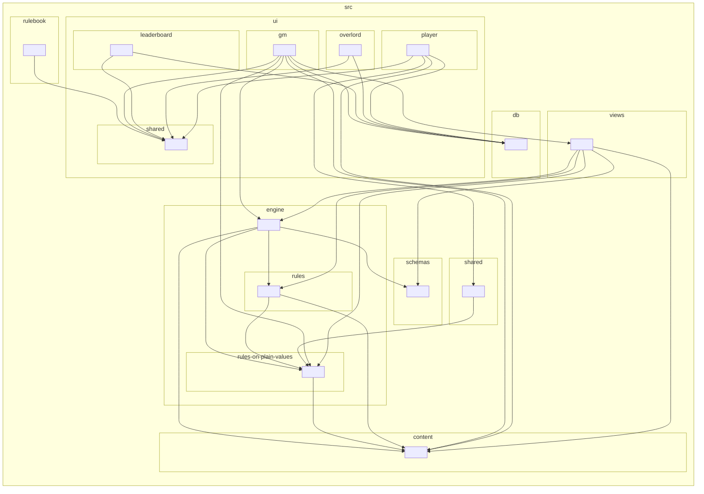

# The layers of `src/` and the module map generated from its imports

Which folder of `src/` may import which is checked by dependency-cruiser: `npm run lint:arch`, in CI's static job and
in `npm run check`, with its rules in `.dependency-cruiser.mts`, every one an error. The overview of the parts is in
[ARCHITECTURE.md](../ARCHITECTURE.md).

## The layers

- **`content/`** (the data file) imports nothing.
- **`engine/`** imports only `engine/` and `content/`; **`engine/rules-on-plain-values/`**, the rules the player portal
  shares, only itself and `content/`.
- **`engine/rules/`**, the rule registry ([the rule registry](the-rule-registry-and-the-one-source-for-shared-rules.md#the-rule-registry)),
  imports only itself, `engine/rules-on-plain-values/` and `content/`: an effect reaches the dice, the turn's state, a
  report or a hero's items only through what its stage and its runner are handed. Each family's registry and its folder
  are there (`unit-abilities/`, `magic-items/`, `spells/`, `discoveries/`, `guardian-perks/`, `alignment-abilities/`);
  the discoveries' unit-class tests are in `engine/rules-on-plain-values/`.
- **`views/`** imports only `views/`, `engine/` and `content/`, and no file that resolves an order, a battle or a fight,
  plays a bot or a turn step, or holds the save code, the dice or the clock (`orders/`, `battle/`, `personal-combat/`,
  `bots/`, `turn/`, `saves/`, `run-turn.ts`, `rng.ts`, `clock.ts`, `world/generate.ts`) but their facts files; the
  prose, **`views/prose/`**, only itself, the engine's facts files (`the-facts-*.ts`), `engine/rules-on-plain-values/`
  and `content/`. Both let a type-only import through. **`shared/`** only `shared/`, `views/`,
  `engine/rules-on-plain-values/` and `content/`.
- **`schemas/`** holds the world's types: any folder may import it with `import type` (TypeScript erases it), and none
  another way but the save's upgrade (`engine/saves/upgrade-a-saved-game-and-check-it.ts`), whose check at load
  parses with it.
- **`db/`** imports only `db/` and `schemas/`, and only the pages' code (`ui/`) imports `db/`. Only `db/` may import
  `@supabase/supabase-js`, and imports only its types: each page makes its client and its `Db` through `db/`.
- **A page's code** (`ui/<page>/`) imports no other page's but `ui/shared/`, which imports only itself. **Only the GM
  page imports the engine** (it runs the turn and edits the world); the player portal, the Hall of Fame and the
  Overlord page reach it only through `shared/` and `views/`.
- **No cycle through imports that bring code**: a cycle of `import type` only is let through. Every import resolves.

## The known findings

What broke a rule when the rules came in is listed in `.dependency-cruiser-known-violations.json` and let through
(`--ignore-known`). It holds one finding: the prose's import of `itemLoreLines` from `engine/items/tiers-and-hoards.ts`,
for the explore and search lines (agreed by a maintainer; it leaves with the fix of the items' other names the engine
adds to the content as it loads). No code has an import cycle, and the no-cycle rule keeps it so. The ratchet counts
the list (`knownArchitectureViolations`), so it only shrinks, and a static test fails while it holds a finding that no
longer occurs.

- **When you fix one,** remove it in the same pull request with `npx depcruise src --baseline --baseline-mode
  shrink-only`. Never add a finding to the list.
- **A cut that leaves part of a cycle** may make dependency-cruiser report some of the findings that stay along another
  path, which shrink-only mode can't follow (dependency-cruiser reports a cycle once, along one path, and matches a
  known one by its set of files). Then rewrite the list with `npx depcruise src --baseline`, check that every entry it
  adds is a cycle among the files still in the cycle and that every import on it was there before, and name in the
  pull request any import the cut adds inside the cycle. A cut that ends a cycle needs only shrink-only mode.

## Unused code

knip finds it (`npm run knip`, `knip.ts`): files nothing imports, exports nothing reads (an export read in its own file
counts as used) and dependencies nothing uses, from the pages' real entries. The ratchet counts what it finds
(`unusedCode`), so it only falls.

## The module map

Generated from the imports by dependency-cruiser (one box a folder; an arrow is an import, `import type` included).
`tests/static/the-module-map-in-its-topic-file-is-generated-from-the-imports.test.ts` fails when it differs from the
code; rewrite it with `npx tsx tools/module-map.ts --write`.

<!-- The module map: generated from the imports by npx tsx tools/module-map.ts --write. Don't edit it by hand. -->

<!-- End of the module map. -->
